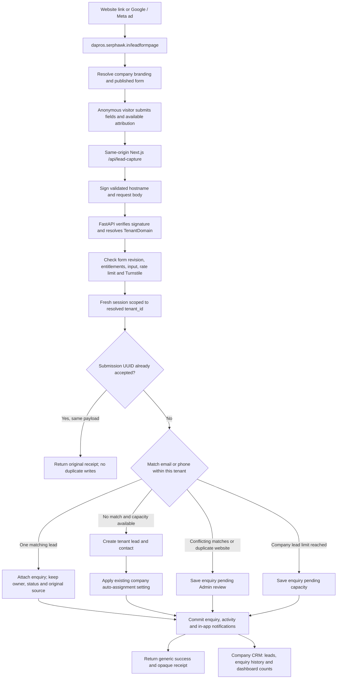

# Company subdomains and website leads: deployment checklist

This is an **incremental rollout onto the already deployed `serphawk_crm_seo` main application**, not a fresh installation. Reuse its existing Vercel project, Railway service, production database, users, tenant rows, module settings and email configuration. Do not create a second deployment or re-onboard existing clients. No production DNS, database, account or hosting settings were changed during implementation. Push remains a separate user-authorized action.

## What is additional to the live main deployment

- New core domain reservations and signed hostname checks; one existing application serves the apex and all assigned company subdomains.
- A same-origin browser API proxy on the existing frontend. Company-specific requests carry signed host context to the existing backend; user bearer authentication still determines identity.
- Public `/leadformpage`, company Admin form editing/publication, attribution and the Website leads enquiry/review screens.
- Four additive tables: `tenant_domains`, `lead_enquiries`, `lead_intake_counters` and `platform_security_settings` (a platform-wide operator-only credential record). Existing leads, contacts, tenants, users, settings, notifications and activity tables continue to be used. This release does not migrate fork databases or recreate production data.
- New hosting variables listed below, wildcard domain/HTTPS setup if absent, Turnstile configuration, explicit domain assignment to existing tenant records and opt-in feature enablement.
- Account-recovery fixes: reset links use a configured canonical company origin and no longer appear in responses/logs. Caller-supplied reset origins are ignored.

Keep current live settings unless the checklist explicitly adds or changes one. In particular, retain the current database URL, encryption keys, `SESSION_SECRET`, SMTP/IMAP settings and any existing DNS/email records. If `serphawk.in` is already attached to this Vercel project, verify it rather than remove/re-add it. Add missing wildcard coverage to that same project. Host enforcement now activates automatically when COMPANY_PROXY_SECRET is present. Coordinate frontend/backend releases and the shared credential; there is no separate enforcement toggle.

## Before pushing code

1. Identify the **existing live** Vercel frontend project and Railway backend service for this repository. The apex application is `https://serphawk.in`. All company names use this same deployment; do not create one project per company. Record the current deployment versions for a coordinated rollback.
2. Check where `serphawk.in` is registered and which provider currently hosts its authoritative DNS. Export the full DNS zone before any nameserver change. Preserve explicit website/infrastructure records and all MX, SPF, DKIM, DMARC and verification records. Never replace the zone with just a wildcard record.
3. Confirm you can use Vercel's documented wildcard-domain setup. It uses Vercel nameservers for wildcard certificate validation. If your registrar/provider prevents the required configuration, resolve that before cutover; an ordinary wildcard CNAME alone is not a substitute for valid wildcard HTTPS. See [Vercel nameservers](https://vercel.com/docs/domains/working-with-nameservers) and [wildcard HTTPS requirements](https://vercel.com/docs/domains/troubleshooting).
4. Create a Cloudflare Turnstile widget and enable hostname coverage for `serphawk.in` and its company subdomains. Verify that a newly allocated subdomain works without adding another hostname manually. After deployment, save the site and secret keys once at `https://serphawk.in/superadmin/security` as the platform SuperAdmin. Do not put either key into deployment variables; the secret must never enter browser variables or source control. Do not use development/test keys in production.
5. Generate a strong random `COMPANY_PROXY_SECRET` (at least 32 random bytes) and save the same value in Railway and Vercel. This is separate from `SESSION_SECRET`, which must remain stable and private on Railway. Do not paste either value in chat, logs or the plan.
6. Arrange a database restore point through your normal production process before deploying the additive tables. Do not use workspace production SQL dumps for local testing.

No per-company DNS configuration is needed. The first release must be coordinated because configuring the shared credential activates strict host enforcement automatically.

## Deployment variables

The non-secret product settings are now in code: company domains are enabled, the base domain is `serphawk.in`, browser API requests use the same-origin proxy, and backend host enforcement activates when the required shared credential is configured. Do not add `COMPANY_BASE_DOMAIN`, `NEXT_PUBLIC_COMPANY_BASE_DOMAIN`, `NEXT_PUBLIC_COMPANY_DOMAINS_ENABLED`, `COMPANY_DOMAINS_READY` or `COMPANY_HOST_ENFORCE`; they are no longer read.

| Service | Credential/configuration | Requirement |
|---|---|---|
| Railway and Vercel | `COMPANY_PROXY_SECRET` | One new private signing value, identical on both services; never a `NEXT_PUBLIC_*` value |
| SuperAdmin settings | Turnstile site and secret keys | Enter once at `/superadmin/security`; stored in the database, with the secret encrypted and write-only |

| Vercel | Existing backend URL | Reuse the existing absolute `NEXT_PUBLIC_API_BASE_URL`, or use server-only `BACKEND_URL`; it must point to Railway, not `/api/backend` |
| Railway | Existing `FRONTEND_URL`, `SESSION_SECRET`, database/mail/encryption settings | Preserve current production values; the canonical apex is `https://serphawk.in` |

There are no per-company deployment variables. Only COMPANY_PROXY_SECRET is newly shared between deployments. Turnstile credentials are managed in SuperAdmin settings, not environment variables; old TURNSTILE_SECRET_KEY and NEXT_PUBLIC_TURNSTILE_SITE_KEY values are no longer read. Public forms fetch the current public site key dynamically, so rotating these settings needs no frontend rebuild. The secret is encrypted using a domain-separated key derived from the existing stable backend SESSION_SECRET. Keep that existing key unchanged; if it is intentionally rotated, re-enter the Turnstile secret in SuperAdmin settings. A missing SESSION_SECRET fails closed instead of storing plaintext.

## Code release and one-time DNS/HTTPS setup

1. Prepare the incremental backend release on the existing Railway service. Without COMPANY_PROXY_SECRET, existing unsigned-host compatibility remains; adding that credential enables host enforcement automatically. Startup adds the three tenant-owned lead/domain tables and the platform-wide `platform_security_settings` table through the existing schema bootstrap. Existing intake webhooks keep their independent key-authenticated contracts. Verify the current live frontend still logs in and accesses its existing tenant data before releasing the new frontend.
2. Coordinate the frontend release and the same COMPANY_PROXY_SECRET on both services, using a short maintenance window if needed. The new frontend always uses the proxy; the backend requires verified host context once its credential is present. Verify apex login and normal CRM access immediately after both releases are active.
3. In the same Vercel project add `serphawk.in`, `www.serphawk.in` and `*.serphawk.in`. Copy the exact DNS/nameserver values shown by Vercel. Do not guess an A record or CNAME from an old tutorial. See [adding a domain](https://vercel.com/docs/domains/working-with-domains/add-a-domain).
4. Reproduce the existing DNS zone at the chosen authoritative provider before switching nameservers. Keep explicit infrastructure records; they take precedence over wildcard coverage. Verify email delivery and the apex site after propagation.
5. Wait until Vercel reports valid domain configuration and HTTPS for the apex and wildcard. Confirm a random previously unused subdomain negotiates HTTPS. It must show a neutral unavailable page, not another company's CRM.
6. As a platform operator, use Configure → Company subdomain → Check platform DNS and HTTPS (`POST /superadmin/domains/check` through the signed proxy). This checks apex and random-wildcard HTTPS reachability. It is a bounded diagnostic; it does not modify DNS or prove tenant routing. Combine its result with the pilot checks below.
7. Assign and test the pilot domains after DNS/HTTPS verification. No readiness/enforcement environment switches are needed. An active reservation reflects configured routing, not independent proof that external DNS/HTTPS is correct. Check proxy login, uploads/downloads and navigation before publishing forms. Provider webhooks retain their documented exceptions.

## Activate the four pilot companies

1. Sign in to the platform SuperAdmin at `serphawk.in`. Verify the real company records in Client Management; do not infer numeric tenant IDs or create duplicate companies.
2. Open each company's Configure drawer and assign its immutable slug: `dapros`, `scmhb`, `scmbpo`, or `serphawk`. Confirm the displayed company/login/form URLs. Reserved and previously allocated names cannot be reused.
3. Enable Leads, Website leads and the desired source-reporting modules using the existing module controls. Domain routing works independently of whether Website leads is enabled.
4. First configure the production Turnstile widget at `/superadmin/security` using the platform SuperAdmin on `serphawk.in`. You can also reach this page from Configure → Company subdomain → Configure platform bot protection. The secret field never displays its stored value; leave it blank to retain it. Then open the company URL in a separate browser profile. Verify its own logo/name, sign in with its company Admin, and confirm the normal modules and dashboards remain on that subdomain. Another company's account must be rejected. Platform operators use the apex for management.
5. As that company Admin, open Website leads. Configure page text, privacy notice, standard/custom fields, services or offered courses. Save and preview, then publish. Publication must not occur until Turnstile and domain readiness are configured.
6. Test `https://dapros.serphawk.in/leadformpage` (and each other company equivalent) without logging in. Use your own test contact details only. Submit one tracked enquiry, repeat the same submission as a retry, and submit another enquiry with the same contact. Verify one lead, separate intentional enquiries, correct source/campaign, company-only visibility and correct assignment.
7. Verify pending conflict/capacity handling, date/source filters, CSV export and first/latest attribution. Check a declined-consent visit and a returning consented visit. Remove test records through normal authorised CRM controls.
8. Check recovery email links use the configured company host, contain no caller-chosen origin, and are never returned in the API response or printed in logs. Verify SMTP separately with an authorised account; no live email was sent by the implementation tests.

If Google sign-in is enabled, register the exact production company origins in the Google OAuth client before offering that login method there. Existing external-provider integrations also need their correct production callback URLs; DNS alone does not configure OAuth providers. Email/password login remains available independently.

Example ad destination: `https://dapros.serphawk.in/leadformpage?utm_source=google&utm_medium=cpc&utm_campaign=design_services`. Use each company's Website leads link builder for its own address. This release records attribution; it does not connect Google/Meta accounts, upload conversions or collect native platform lead forms.

## Future company onboarding

Create the company/Admin in Client Management, review its suggested account/subdomain name and submit. The company, initial Admin, domain reservation and preset are written together. Creating an additional Admin does not allocate another domain. With wildcard infrastructure ready, the new hostname uses the existing deployment and HTTPS; no new DNS record is required. Company Admins publish their own `/leadformpage` after configuration.

Existing companies use Configure → Company subdomain. Anonymous trials and demo clones cannot reserve a customer's subdomain. Company renaming changes branding but not its URL. Domain-bearing workspaces cannot be deleted through the generic delete action because their reservations must not be recycled.

## Developer guide: lead flow in the shared architecture

### 1. Receiving company and visitor identity are separate

`dapros.serphawk.in` resolves through `tenant_domains` to the existing DaPros tenant. The browser never chooses a `tenant_id`, salesperson or CRM status. A visitor can enter their own company name, but that becomes `Lead.company_name`; it does not choose the receiving company. Every created lead/contact/enquiry/activity is explicitly stamped with the resolved DaPros `tenant_id`.

`lead_enquiries.receiving_company_name` is a historical snapshot of the receiving brand, and `hostname` records the verified company address. Stable tenant IDs enforce ownership even if either company later changes its display name. Wildcard DNS only delivers traffic to the deployment; a matching active database reservation is still required.

### 2. Public form access needs no CRM account

`/leadformpage` uses a separate public layout. No login, registration, CRM role provider, CRM offline queue or email confirmation dialog is involved. The form obtains only published fields and public brand data. An optional attribution-consent choice is separate from contacting the company; declining it does not block the enquiry.

The browser posts to its own origin, for example `https://dapros.serphawk.in/api/lead-capture`. Next.js uses its private service secret to sign the hostname, method, target, timestamp, body hash and trusted proxy IP context. This service-to-service signature proves request context; it is **not** a visitor login. The browser never receives that secret. Form submissions do not inherit any signed-in CRM user's bearer token.

FastAPI validates the signature and looks up the exact active hostname in a short-lived lookup session. It closes that session before opening the tenant-scoped business session, preventing the lookup's RLS bypass from carrying into lead writes. Unknown domains, unpublished forms, missing entitlements and invalid verification fail closed.

### 3. Lead creation, repeated enquiries and assignment

The new flow runs through `addons/lead_capture`, rather than calling the legacy manual `POST /leads` handler. This avoids that handler's automatic research/WhatsApp side effects. No automatic research, SMTP, WhatsApp or recurring worker starts from a public enquiry.

- The submission UUID is unique per tenant. A retry of the same payload returns its original receipt; a changed payload with the same UUID is rejected.
- A company-level transaction lock serializes duplicate decisions. Normalised email/phone checks never search another tenant. The same contact can therefore be a legitimate lead in both DaPros and SCM HB.
- One matching lead receives another enquiry. Its owner, status, original source and converted client/student relationship remain intact; a converted lead is not silently reopened.
- A new prospect creates one lead and contact. Existing `lead_auto_assign` and `lead_assignment` settings control workload/revenue assignment. If disabled or no eligible staff exist, the lead stays unassigned for its company Admin.
- Ambiguous contact matches or an existing prospect website go to `pending_conflict`; the company Admin explicitly links a same-tenant lead. A reached lead cap produces `pending_capacity`; the Admin can retry after capacity is available. Both cases retain the enquiry and notify Admins instead of silently losing the visitor's message.
- The business transaction commits the lead/contact where applicable, durable enquiry, activity and in-app notifications together. Admins and an assigned owner are notified. A database error returns a safe retry response, not false success or SQL/contact details.

### 4. Attribution does not determine tenant ownership

Store capture method, source/channel, allowed UTM tags, click IDs, landing/submission path and consent metadata with the enquiry. `Lead.website` is the prospect's own website, not the hosted form URL. Preserve original acquisition on the lead and keep later campaign interactions as separate enquiries.

Google/Meta ad destinations use the company's exact public form URL. Campaign names come from UTM parameters; click IDs alone do not supply campaign names, and `fbclid` alone does not establish paid traffic. With consent, host-local storage remembers the first visit and latest campaign for a fixed 30-day period. Direct returns do not erase that campaign. Without consent, only current-visit attribution is used. Unrelated query strings and referrer query parameters are not retained.

### 5. How the lead appears in the correct CRM

Company staff log in at their company subdomain. Signed host context must agree with the authenticated user's actual tenant. Knowing a hostname or sending an `X-Tenant-ID` header cannot grant access. Platform SuperAdmins use the apex management UI and are not ordinary CRM users within company subdomains.

Existing `Lead` rows remain the CRM's source of truth for pipeline, ownership and conversion. The new enquiry table references those leads; it is not a second isolated lead database. Existing ORM tenant filters and Postgres RLS cover the new tenant-owned tables. Website enquiry endpoints additionally apply role/owner visibility, and unresolved enquiries are Admin-only.

The Leads detail page shows linked enquiry history. Website leads provides source/campaign/date filters, review actions and CSV export. Dashboard widgets separate new leads from repeat enquiries and pending enquiries so a returning visitor does not inflate unique lead counts. Conversion summaries count acquired leads once using the original source. Existing records without recorded campaign evidence remain unknown; historical attribution is not fabricated.

### Interfaces and code ownership

| Responsibility | Implementation / interface |
|---|---|
| Core hostname reservations, canonical origins, signed host checks | `database.TenantDomain`, `modules/company_domains.py`, `routers/company_domains.py`; `/superadmin/tenants/{id}/domain`, `/tenant/domain` |
| Same-origin browser proxy and public submit bridge | `frontend/src/lib/companyProxy.ts`; `/api/backend/*`, `/api/lead-capture` |
| Public branding before login | `/internal/company-brand`, `CompanyBoundary`; only approved public brand fields |
| Draft and published form settings | `lead_form_draft`, `lead_form_published` in the existing tenant-settings schema; `/tenant/lead-capture`, `/tenant/lead-capture/publish` |
| Form validation, bot verification, enquiries and attribution | `addons/lead_capture/`; `/internal/lead-capture/config`, `/internal/lead-capture/submit` |
| Staff history, reports, export and pending review | `/lead-capture`, `/lead-capture/lead/{id}`, `/lead-capture/export`, `/lead-capture/{id}/resolve` |
| Frontend public form and company Admin editor | `/leadformpage`, `/website-leads` |

Do not duplicate the codebase for another company or put routing logic into ad tags. Add per-company variations through tenant settings, entitlements and existing presets/add-ons. The older `/leads/webhook`, `/api/leads/webhook` and institute `/leads/intake` integrations retain their separate contracts; changing an existing external website to the new flow is a separate integration task.

## Rollback

Unpublish a form or disable Website leads to pause intake without disabling company CRM. Keep recorded enquiries and domain reservations. If the browser proxy release must be rolled back, first coordinate a compatible backend configuration so users are not stranded by strict host enforcement; never disable signed user authentication or tenant isolation. DNS/mail rollback requires the exported zone and provider instructions. Do not delete the additive tables or automatically reassign retired domains.

## Validation and production handoff

Email Agent's **Save as Draft** records `status=Draft`, preserves an existing lead's status, creates a new prospect as `New`, and logs draft creation without SMTP or webhook delivery. The existing non-null `sent_at` column records the draft's save time; delivery status is determined by `status`, and the Inbox Sent view excludes drafts. Previously mislabelled historical records are not rewritten automatically.

The temporary local Docker configurations, local walkthrough, generated logs and local Turnstile exception were removed after manual testing. Feature regression tests remain in the repository. Production verification always requires a real Turnstile key, matching company hostname and `lead_capture` action; dummy secret keys are rejected.

Previous implementation verification included 696 passing backend tests with Postgres/RLS/migration coverage, focused onboarding and isolation checks, frontend type checks and a production build. Those historical runs do not replace the production pilot checks above.

Before deployment, review **Before pushing code**, **Deployment variables** and **Code release and one-time DNS/HTTPS setup**. After deployment, follow **Activate the four pilot companies**. Fellow developers should read **Developer guide: lead flow in the shared architecture** for the diagram, ownership rules and API map.

Do not deploy any local proxy/session secrets, dummy Turnstile keys, `LEAD_CAPTURE_LOCAL_TEST`, local database URLs or disposable operator credentials. Generate a new private proxy secret shared only by the deployed frontend and backend; preserve the existing production session/encryption/database credentials. Frontend `NEXT_PUBLIC_*` changes require a rebuild. Coordinate the shared credential and frontend/backend releases, since the credential now activates host enforcement automatically. Verify DNS/HTTPS before publishing forms.
