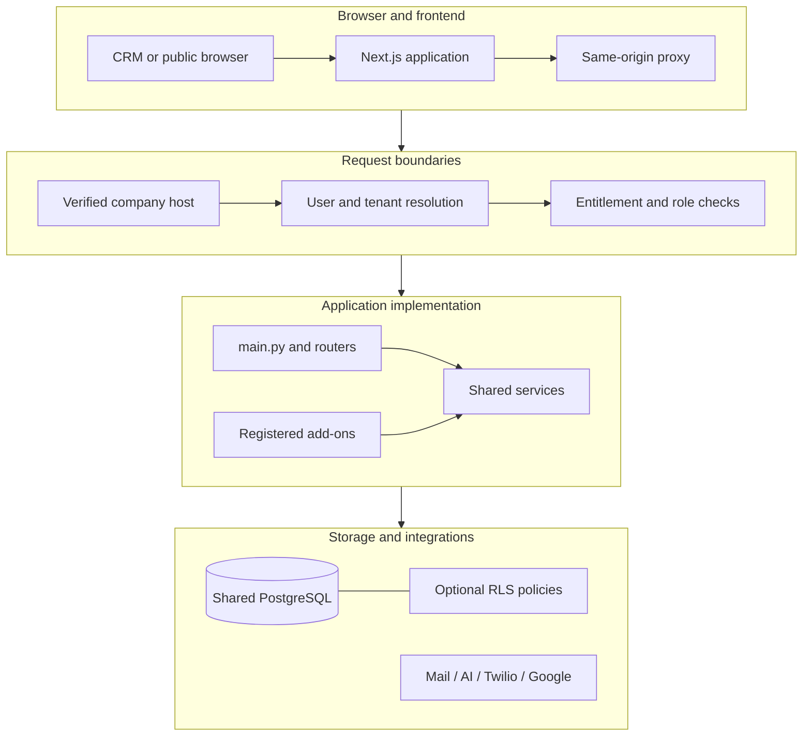
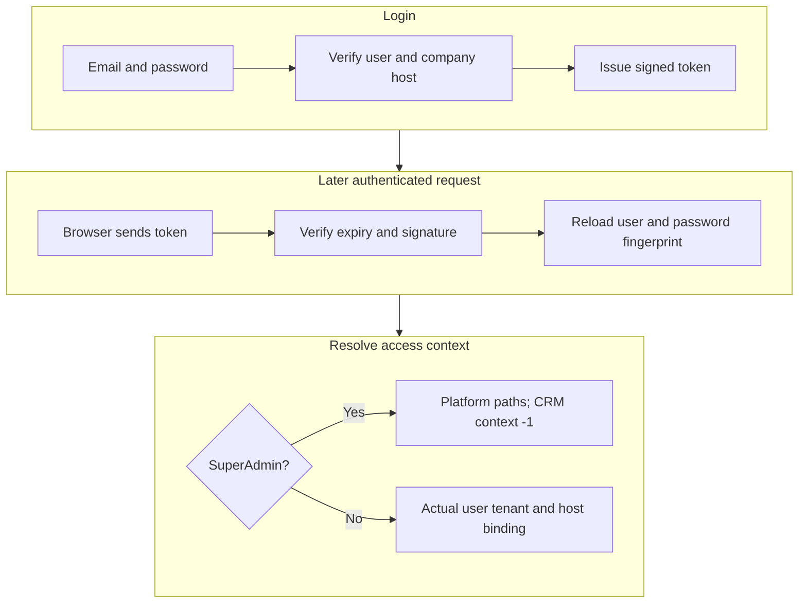
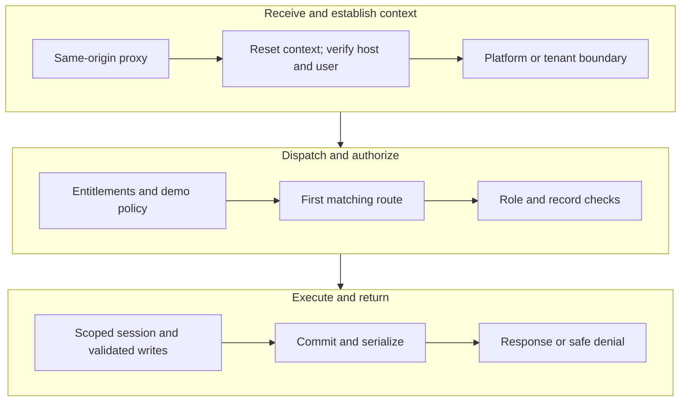
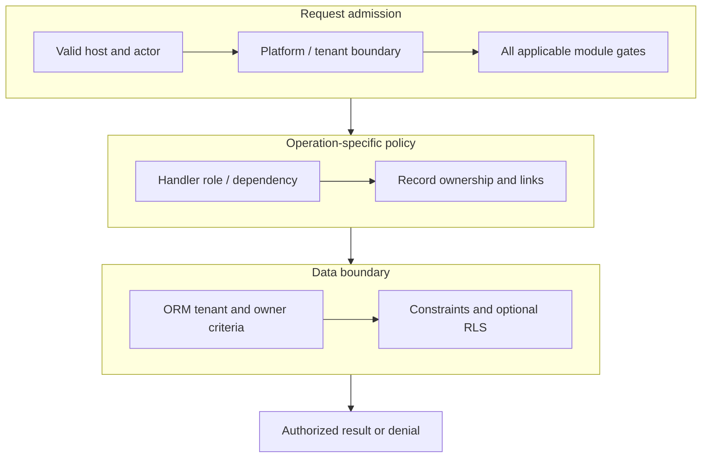
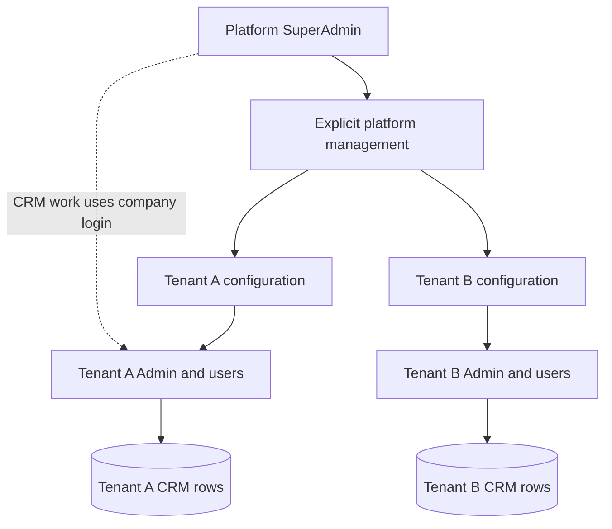
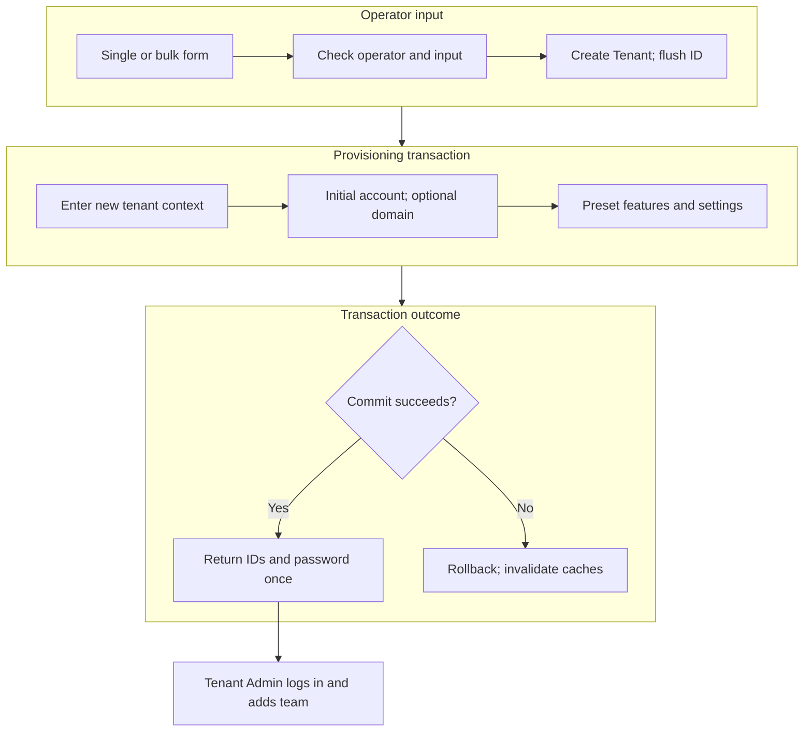
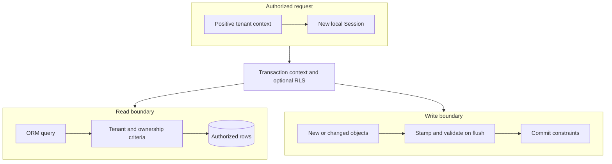
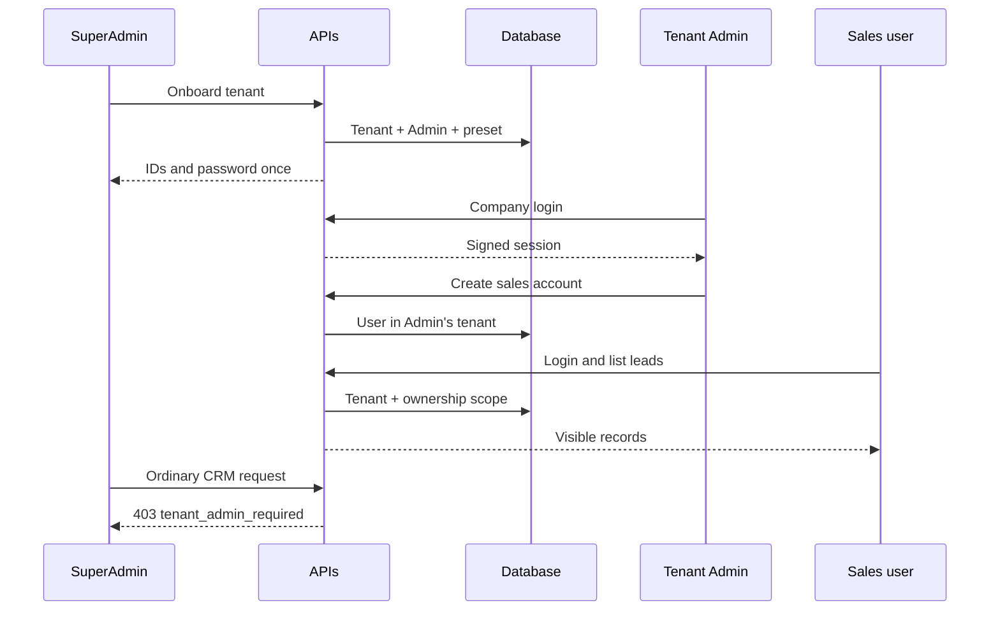

# SERP Hawk CRM SEO

# Multi-Tenant Architecture & Developer Handbook

**Engineering onboarding and implementation reference**

Reviewed: 18 November 2026  
Repository: `serphawk_crm_seo`  
Source baseline: `main` at `cc57bad04561d37d2a6dc708aac787f64796d518`  
Audience: backend, frontend, QA, and technical leads joining the product team.

This handbook describes the checked-out implementation. It is not a statement that every deployment has the same configuration, that every route is secure, or that historical tests have just passed. Application code, production configuration, customer databases, and existing documentation were not changed to prepare it.

The companion PDF is generated from this Markdown. Code marked **illustrative addition** is a development example, not an endpoint already present in the repository. All people, companies, IDs, and request bodies used in walkthroughs are synthetic. Password and token placeholders must be replaced only in an isolated development environment.

## Contents

1. [Orientation and architecture](#1-orientation-and-architecture)
2. [Authentication, host verification, and tenant resolution](#2-authentication-host-verification-and-tenant-resolution)
3. [Roles, authorization, and access boundaries](#3-roles-authorization-and-access-boundaries)
4. [SuperAdmin control and tenant lifecycle](#4-superadmin-control-and-tenant-lifecycle)
5. [Data model and tenant isolation](#5-data-model-and-tenant-isolation)
6. [Module and frontend architecture](#6-module-and-frontend-architecture)
7. [Integrations, background work, and configuration](#7-integrations-background-work-and-configuration)
8. [Safe developer setup and validation commands](#8-safe-developer-setup-and-validation-commands)
9. [End-to-end scenario: operator onboards a tenant](#9-end-to-end-scenario-operator-onboards-a-tenant)
10. [End-to-end scenario: tenant-admin user management](#10-end-to-end-scenario-tenant-admin-user-management)
11. [End-to-end scenario: add a tenant-aware module](#11-end-to-end-scenario-add-a-tenant-aware-module)
12. [Non-Negotiable Multi-Tenant Development Rules](#12-non-negotiable-multi-tenant-development-rules)
13. [Testing strategy and PR checklist](#13-testing-strategy-and-pr-checklist)
14. [Quick developer reference](#14-quick-developer-reference)
15. [Discrepancies, limitations, and open questions](#15-discrepancies-limitations-and-open-questions)
16. [Glossary](#16-glossary)
17. [Evidence and source inventory](#17-evidence-and-source-inventory)
18. [Model catalogue](#18-model-catalogue)

## 1. Orientation and architecture

### 1.1 The product model

One FastAPI backend and one Next.js frontend serve many independent organizations. Each organization is a `Tenant` row. Its users belong to that tenant through `User.tenant_id`; its CRM rows generally carry the same `tenant_id`. Different organizations use the same code and schema, with different data, settings, and feature entitlements.

A **tenant** is the company receiving the CRM service. A **CRM client** is a `ClientProfile` managed inside that company's CRM. These are different entities. For example, synthetic tenant *Northstar Agency* can have *Harbor Tools* as a lead and later a client. Harbor Tools does not thereby become a tenant. An onboarding response's `admin_user_id` is a user ID, not a client-profile ID.

The platform SuperAdmin manages organizations through explicit platform interfaces. This is a separate access boundary from working inside a company's CRM. The current HTTP middleware refuses ordinary CRM requests from platform operators; an operator must use a company account to perform that company's CRM work. Supplying `X-Tenant-ID` does not turn an operator session into tenant impersonation.

There is no universal permission hierarchy such as “SuperAdmin inherits every Admin operation, and Admin inherits every salesperson operation.” Role helpers, route-specific lists, ownership conditions, middleware, entitlements, and host constraints combine to determine effective access. Chapter 3 explains these combinations.

### 1.2 What is shared and what varies

| Concern | Shared implementation | Organization-specific state |
| --- | --- | --- |
| Identity | Signed-session implementation and globally unique user emails | User membership, active status, stored role, password |
| CRM data | Models, routes, services, database schema | Leads, clients, contacts, projects, messages, commercial and institute records |
| Product availability | Feature registry and route/page mappings | `tenant_features` overrides and presets applied to a tenant |
| Appearance and behavior | Validated settings schema and branding utilities | Brand, logo, currency, language, statuses, assignment defaults, supported role-policy overrides |
| Company routing | One frontend proxy and backend host verifier | Active or retired `TenantDomain` reservation |
| Integrations | Mail, AI, telephony, calendar and intake code | Connected user mailbox, company mailbox, tenant-owned integration records |
| Platform services | Provisioning, security settings, management APIs | Operator-chosen configuration for a named tenant |

Do not implement company differences by copying the repository. Use a setting for a configurable variation, a feature entitlement for availability, and an add-on package for a substantial capability. Presets package initial choices; they are not separate deployments.

### 1.3 High-level architecture



The diagram shows normal HTTP flow. Provider webhooks and the chat WebSocket have separate authentication/context paths and must be reviewed independently.

### 1.4 Entry points and folders

| Location | Responsibility and development implication |
| --- | --- |
| `main.py` | Creates `app`, registers middleware/routers, installs ORM event hooks, bootstraps the database, and holds most legacy route handlers. Search it before adding a route. |
| `database.py` | Core SQLModel tables, engine construction, and additive schema bootstrap. Importing it is configuration-sensitive; reading it statically does not need a database. |
| `routers/` | Newer route groups: tenant config, registration, workspace, inbox, follow-ups, campaigns, domains, demos, imports, conversations, voice and more. |
| `modules/` | Shared authentication, tenant scoping, settings, entitlement, ownership, branding, mail, AI, duplicate prevention, and runtime services. |
| `addons/` | Business suite, institute, and lead capture. `addons/__init__.py` imports models and mounts routers through `register(app)`. |
| `frontend/src/app/` | Next.js App Router pages and server route handlers. Page folders represent browser URLs, not automatically backend API paths. |
| `frontend/src/context/` | Session, tenant configuration, branding consumers, language, notifications, theme, and synchronization state. |
| `frontend/src/components/` | Shared layouts, Sidebar, CompanyBoundary, ModuleGate, forms and module components. |
| `scripts/` | Schema checks, synthetic demo seeding, tenant imports/comparisons, and performance utilities. Some scripts write data; inspect their flags before execution. |
| `tests/` | Unittest fixtures and backend regression coverage; some cases require a disposable PostgreSQL database. |
| `docker/`, `docker-compose.yml` | Local backend/test image and PostgreSQL development services. See the credentials caveat in chapter 8. |

Routers included near the start of `main.py` register before later decorators. Starlette dispatches to the first matching route, including parameterized matches. A later function with the same method and path does not replace the earlier route. Current duplicate examples include client service extraction and lead notes. Python function-name rebinding and route registration are separate mechanisms.

## 2. Authentication, host verification, and tenant resolution

### 2.1 Keep three questions separate

**Authentication:** is this a real, active user with a valid credential? **Tenant resolution:** which company's data context applies? **Authorization:** may this actor perform this particular operation on this particular record? A successful login answers the first question; it does not grant every operation in the resolved tenant.

The normal session credential is `Authorization: Bearer <signed token>`. `modules/auth_tokens.py` implements a custom HMAC-SHA256 token, not an OAuth access token or a standard JWT. Its format is `v1.<base64url JSON>.<signature>`. The payload contains `uid`, issue/expiry times, and a fingerprint of the stored password. It does not carry authoritative role or tenant claims.

`SESSION_SECRET` provides the signing key. Without it, the implementation generates a per-process random key: sessions stop working across restarts or different processes. The default lifetime is seven days, subject to `SESSION_TTL_SECONDS`. Never embed the secret or a real token in documentation, frontend source, URLs, or logs.

### 2.2 Login and subsequent requests

`main.py::login` looks up the globally unique email using a deliberate unscoped query, verifies the password, checks company-host compatibility, rejects inactive accounts, and returns a serialized user plus a signed token. Password verification supports historical SHA-256, bcrypt in the alternate hash field, and legacy plaintext forms. New `_hash_password` writes remain unsalted SHA-256; do not describe this as a modern password-storage design.

The frontend's `RoleContext` stores `crm_user` and `crm_token` in local storage. The user object drives presentation and initial routing; it is not a trusted server-side authorization record. The fetch interceptor adds the bearer token to internal API calls and applies the global email confirmation behavior. A logout clears local storage. There is no independent token revocation list in this token implementation.

For each ordinary HTTP request, `APIIntelligenceMiddleware.dispatch` resets request contexts and:

1. Resolves and validates company-host context when supplied or required.
2. Verifies the bearer token, then loads the user from the database.
3. Checks the password fingerprint and active status; a changed password invalidates older tokens.
4. Validates that a company-host-bound request belongs to that user's actual company.
5. Assigns the user's actual `tenant_id` for a tenant user. An operator receives the invalid CRM context `-1`.
6. Enforces platform/tenant boundaries, module restrictions, and applicable demo policy before dispatch.
7. Allows the handler's own authorization and scoped database work to run.

The database user row remains authoritative, so server-side role and active-status changes take effect without trusting the cached browser role. This does not mean a browser instantly refreshes every visual label.



### 2.3 Company host context is a separate credential boundary

`frontend/src/config.ts` fixes the browser API base to `/api/backend`. The Next.js catch-all route calls `companyFetch` in `frontend/src/lib/companyProxy.ts`, which chooses its backend destination from server configuration. The private `COMPANY_PROXY_SECRET` signs method, target, hostname, timestamp, body hash, and trusted proxy IP context. Only selected request headers are forwarded; the proxy does not forward the legacy tenant-selection header as an authority.

`modules/company_domains.py::resolve_request` verifies signature freshness and matches a company subdomain against a non-retired `TenantDomain`. A matching hostname is necessary for company-bound flows but is not a user login. `check_user` rejects a user from another company and rejects platform SuperAdmins on company subdomains. An unknown or retired company name does not fall back to another tenant.

Host enforcement activates when `COMPANY_PROXY_SECRET` is configured. There are explicit webhook/static/health exceptions and a localhost development exception. The base domain is currently a code constant, not a generic custom-domain management system. DNS or wildcard HTTPS alone does not create a tenant-domain reservation.

Use the apex platform UI for operator management. Use the appropriate company login for company work. The application is not a system where a frontend can choose any organization by modifying a header.

### 2.4 Context values and compatibility

| Value/mechanism | Meaning |
| --- | --- |
| Positive `current_tenant_id` | Authorized tenant context for business operations |
| `-1` | Anonymous, invalid, or platform-operator CRM context; never a real tenant |
| `None` | Trusted startup/background context; ORM filtering is bypassed, not denied |
| `using_tenant(tid)` | Scoped context manager that restores the previous tenant after its block |
| `platform_management_write` | Narrow write exception set for an authenticated operator's `/superadmin/` management request |
| `LEGACY_USER_HEADER` | Compatibility mode; function default is off. Explicit enablement accepts unsigned identity through supported old paths. |

A bad or expired bearer token does not fall back to `X-User-ID`. Do not enable legacy identity in a deployed environment to make a failing integration “work.” Some older test fixtures deliberately enable it; that is not the production default.

### 2.5 Public routes and non-HTTP paths

Public access is implemented route by route. Website lead capture uses a signed host bridge plus Turnstile, publication and entitlement checks; legacy intake uses a company key; proposal links use a UUID; Twilio callbacks use per-call tokens, with optional provider signature validation. Login, registration and password recovery have their own validation and rate-limit behavior. Public does not mean allowed to submit arbitrary tenant IDs.

The chat WebSocket does not inherit the HTTP middleware path. `main.py::ws_chat` resolves the credential, checks thread membership through `_chat_user_can_access`, and sets its tenant context separately. Review its implementation whenever changing sessions or chat access.

Password recovery now builds a canonical origin through `company_domains.canonical_origin`; the supplied `redirect_url` is not used to choose the reset destination. The forgot-password response is generic. Do not repeat the older claim that current handlers intentionally return reset links.

### 2.6 Complete ordinary API request lifecycle



Public handlers use their own credential/tenant-resolution branch instead of the ordinary signed-user branch. WebSockets have separate dispatch. Do not infer one universal HTTP error code for every denial: a hidden record commonly returns 404, a disabled module 403, and an unavailable public form can intentionally return a neutral unavailable response.

## 3. Roles, authorization, and access boundaries

### 3.1 Effective access is an intersection



Failure at any required layer stops the request. A role accepted by a helper can still be rejected earlier by middleware. A visible menu entry cannot grant a server permission. A missing frontend gate cannot safely be treated as an authorization policy.

### 3.2 Actor boundary matrix

| Actor | Implemented access and boundary | Evidence |
| --- | --- | --- |
| Platform SuperAdmin | Operates platform tenant/config/domain/security/request interfaces. Ordinary CRM routes return `tenant_admin_required`; company-host checks also reject operator accounts. It is not automatic CRM impersonation. | `APIIntelligenceMiddleware.dispatch`; `tenant_config._super`; `company_domains.check_user` |
| Tenant Admin | May create supported non-platform accounts in the current tenant, deactivate/restore users, manage company settings, sales access, mailbox configuration, and company requests through the relevant handlers. Cannot mint a SuperAdmin or assign tenant entitlements through operator-only APIs. | `create_user`, `delete_user`, `restore_user`; tenant config/workspace routers |
| Ordinary tenant user | Belongs to one tenant, but permitted actions depend on actual role and endpoint. No “ordinary user” role grants uniform CRUD everywhere. Several legacy handlers rely on scoping rather than explicit role lists. | Route handlers, `_require_roles`, session hooks |
| SalesManager / Sales / legacy Employee | Core lead/client/contact/call access receives ownership criteria. Sales module access is tenant entitlements intersected with sales overrides; teams is disabled and reports defaults off for this group. Assignment/reassignment has additional checks. | `modules/sales_access.py`; `before_flush`; tenant sales-access API |
| Intern / ProjectMember / Developer | Different workflow-specific access: project/work queue, tasks, tickets, and cases use their own checks. These roles are not interchangeable and are not automatically salespeople. | Work queue, project/task/ticket/case handlers |
| Admissions | Admissions APIs authorize assigned student/enrollment work; management assignment actions are narrower. Does not inherit general sales, inbox or institute administration. | `addons/institute/admissions.py::_admissions_actor` and student filters |
| Student / Instructor | Institute portal handlers resolve profile/user and enrollment or teaching relationships. Portal access does not grant CRM administration. | Institute route portal helpers and `_require_enrollment_access` |
| Client | Portal relationships use `ClientProfile.userId`; invoice criteria can restrict to that client. Some legacy client-record handlers lack a matching explicit ownership check: this is a gap, not a permission grant to all client data. | `sales_access.criteria`; `get_client`; portal handlers |
| Supplier | Supplier/RFQ handlers use linked supplier-account relationships. The Supplier layout is presentation; each backend operation remains independently authorized. | Inventory/supplier and RFQ handlers in `main.py` |
| Demo | Broad access in selected handlers, subject to workspace record/service limits and blocked bulk workflows. Demo is neither an Admin alias nor a free pass to paid services. | Inbox viewer, demo usage guards, relevant route checks |
| Public / anonymous | Only explicit public contracts should be used. No tenant identity may be chosen through a header/body alone. Public handlers must establish their own tenant and scope after validating the public credential. | Company domains, lead capture, intake, tracking, proposal, voice handlers |

### 3.3 Normalization is not uniform

`main.py::_normalize_role` canonicalizes common case/spacing variants; `Sales` is normalized to `SalesManager`. `_user_dict` presents legacy Employee accounts as SalesManager while retaining their database IDs. `create_user` also converts a requested Employee role to SalesManager.

Other modules do not all call this helper. Inbox `_role_of`, institute helpers, voice `_current_user`, and business-suite helpers have different normalization rules or raw-role comparisons. For example, default Inbox scoped roles are `SalesManager` and `Employee`; a database row literally stored as `Sales` is not automatically admitted by that particular helper. Check stored role, helper normalization, serialized role, and route behavior separately.

Known user-creation role values include SuperAdmin, Admin, SalesManager, Employee, Intern, Client, Supplier, Demo, ProjectMember, Developer, Student, Instructor, Sales and Admissions. That validator is not a central RBAC registry. Tenant settings' role-policy validator supports a different set, and only supported policy areas consume it.

### 3.4 Representative registered operations

| Operation | Effective behavior to rely on |
| --- | --- |
| `POST /superadmin/tenants` | `_super` requires the platform role; creates one initial account and preset/config records. |
| `PUT /superadmin/tenants/{id}/features` | Operator-only entitlement changes; ordinary tenant Admin is rejected. |
| `POST /users` | Entry guard `_require_roles(..., ["Admin"])`; Tenant Admin may create known non-SuperAdmin roles in its own tenant. Internal SalesManager mapping is unreachable for an ordinary SalesManager. |
| Operator `POST /users` | Middleware has a special exception for this path. A SuperAdmin account can create another platform account; creating a tenant user still requires a positive tenant context, which this operator request does not acquire. Use onboarding for initial tenant users. |
| `GET /users` | Tenant-filtered; global sales criteria further restrict sales actors to their own user row. It is not simply a universally Admin-only list. |
| `DELETE /users/{id}`, restore | Admin guard and same-tenant lookup; deactivation can redistribute/reassign linked work. Inspect response and reassignments rather than treating deletion as a simple row removal. |
| `GET /leads/{id}`, `/clients/{id}` | Tenant scoping, plus sales criteria where applicable; missing visible records return 404. Client/non-sales ownership coverage is uneven. |
| `GET /inbox/messages` | Inbox role policy admits the actor, then content is limited to the account's connected mailbox, including Admin. No connected IMAP mailbox means no message rows. |
| Record email composer | Inbox viewer plus record ownership/full-access check. Tenant-wide record access and mailbox visibility are separate concepts. |
| `POST /followups/run-now` | Viewer dependency plus Admin/SuperAdmin role restriction, valid company context, bounded and rate-limited work. Platform middleware still blocks operator CRM use. |
| `GET /cases`, case detail/update | Specified staff roles; non-Admin/non-Demo viewers are restricted to assigned cases. Delete uses the Admin helper. |
| `POST /projects` | Admin/Demo guard, valid same-company related records/team members; do not generalize that list to every project route. |
| `/admissions/students` | Admin/Admissions/Demo route checks plus assigned-student rules for Admissions; assigning staff uses management checks. |
| `POST /import/leads/csv` | Supported internal roles, tenant-aware import, duplicate handling and limits; both import entitlement and target CRM section gates apply. |

**Legacy exception to flag:** `_is_admin_user` and business-suite `_require` still contain an email-address-based privileged exception. The central `_require_roles` uses roles, but it is not the only authorization helper. Do not reproduce the email exception in new code or claim that all authorization is centrally uniform.

### 3.5 Tenant role policy and sales overrides

`role_policy` is not an arbitrary permission engine. Its supported area currently concerns Inbox full/scoped access; follow-ups and campaigns use the Inbox viewer and inherit relevant viewer policy. The default full-access roles are Admin, SuperAdmin and Demo, with SalesManager/Employee scoped. The outer platform boundary still applies, and explicit checks within a workflow can further restrict an admitted role.

`sales_module_access` is a separate tenant setting. `effective_modules` starts with tenant entitlements and ANDs supported sales overrides: an override cannot enable a module that the tenant lacks. This controls module availability for the sales-role group; it is not a per-user ACL system or a way to give a Client the Admin role.

## 4. SuperAdmin control and tenant lifecycle

### 4.1 Implemented management surface

The frontend's `/superadmin/clients` page is the tenant-management interface, despite the word “clients” in its URL. `routers/tenant_config.py` owns onboarding/configuration; `main.py` also contains operator tenant lists, usage/limits and telemetry routes. Related platform functions live in company domains, demo accounts and customization requests routers.

| Capability | Implemented mechanism |
| --- | --- |
| Single/bulk onboarding | `POST /superadmin/tenants`, `/superadmin/tenants/bulk` -> `_onboard` -> `onboarding.create_workspace` |
| Initial account | `account_role` accepts Admin or SalesManager; default Admin. One account is created, not a prefilled department of users. |
| Modules/settings | Catalog/config reads; tenant feature updates or preset application; validated settings updates; logo/domain operations |
| Trial/usage | Tenant limits, usage reset and `is_trial` changes through implemented operator handlers; separate durable demo quotas also exist |
| Demo management | Separate demo workspace creation, account activity/status/password operations, conversion, and guarded deletion |
| Product requests | Tenant request conversations and operator status/reply management |
| Global bot security | Operator-only Turnstile settings, encrypted secret storage and domain diagnostics |
| Tenant deletion | Name confirmation, platform-user protection, linked-demo checks, domain-reservation protection, and `delete_workspace` |

The `Tenant` model has no general `is_active`/`suspended` field. Do not document a universal tenant-suspension switch. User activation/deactivation, trial controls, domain retirement, and form publication are distinct implemented controls; disabling a form does not suspend its CRM. Inspect each handler before promising a lifecycle effect.



### 4.2 Provisioning and initial configuration

`modules/onboarding.py::create_workspace` creates the tenant, enters `using_tenant(new_id)`, creates the initial user and optional domain reservation, applies the preset and settings, and commits. Errors roll back the operation and invalidate caches. Global email uniqueness prevents a person from using the same email as two different tenant accounts.

The operator flow validates unique tenant name, known preset, account role and email. It accepts a supplied initial password or generates one returned once. This response is sensitive and must not be retained in logs, tickets or documentation. Choosing SalesManager for the initial account does not secretly grant Admin user-management rights.

Visible preset choices currently include `serphawk`, `standard`, `bpo` and `full`. Legacy names such as `agency`, `agency-voice`, `institute` and `design-agency` remain accepted through the preset resolver even when hidden from the chooser. `apply_preset` writes an explicit entitlement row for every registered feature, handles dashboard section keys, and merges settings. Applying another preset can therefore change many switches; it is not a harmless label edit.



Self-registration is a different public entry point: signup email verification, rate limits, profile recommendation, trial workspace, operator notice, and token response. Registration can add a lead to the platform's own named CRM tenant when that tenant exists. A new Google sign-in uses the self-service demo path. These are deliberate provisioning flows, not justification for arbitrary public cross-tenant writes.

### 4.3 Settings, plans and demos

Tenant settings live in one validated JSON row; `PUBLIC_KEYS` limits the subset exposed through `/me/features` or non-Admin settings reads. Company Admins configure brand, defaults, supported sales access and mailbox-related settings. Operators manage tenant feature entitlements. Platform bot credentials use the separate `PlatformSecuritySettings` record; they are not a tenant's branding setting.

Trial/demo restrictions are implemented, but this is not evidence of a full automated subscription payment platform. `demo_usage.py` has durable shared budgets, a five-record limit per grouped primary resource, five paid AI requests, and two phone calls, alongside older Tenant limit/counter fields. The middleware and transport guards enforce relevant policies. Do not use old onboarding examples of limits as a complete current quota specification.

Changing `is_trial` alone does not erase every Demo-role restriction. Demo conversion APIs coordinate supported account/workspace changes; document and use those flows. A Demo account in an ordinary tenant and a separate `demo_of_tenant_id` workspace are different cases.

### 4.4 Migration and backward compatibility

`scripts/migration/inspect_source.py`, `import_tenant.py`, and `compare_tenant.py` inspect a source database, remap supported data into a tenant, and compare results. The import path creates/remaps users and IDs, handles email conflicts, translates supported follow-up schemas and avoids copying platform credentials/session tokens. It can replace an existing target tenant when explicitly requested: replacement is destructive within that target.

Migration rehearsal is a separate controlled task with synthetic or authorized database copies. A valid code import does not move local upload files, preserve an incompatible mailbox encryption key, or reconfigure provider OAuth apps. Never run these scripts merely to read this handbook, and never treat historical deployment rehearsal counts as current verification.

## 5. Data model and tenant isolation

### 5.1 Important relationships

| Entity/link | Meaning and validation requirement |
| --- | --- |
| `Tenant` -> `User.tenant_id` | User belongs to one company; platform accounts can have no tenant. Email uniqueness is global. |
| `Tenant` -> `TenantFeature`, `TenantSettings`, `TenantAsset`, `TenantDomain` | Module switches, JSON configuration, database logo, and company-host reservation |
| `Lead.owner_id` / `created_by` | Ownership and creator used by sales visibility; name strings are not the authorization identity |
| `ClientProfile.userId` | Linked client portal login; distinct from sales assignee |
| `ClientProfile.assignedEmployeeId` / `created_by` | Staff ownership used by sales filters |
| `Contact` and contact link tables | Contacts can attach to leads/clients; both sides and hierarchical parent contacts must belong to the tenant |
| Lead -> converted client/student | Conversion preserves links to CRM or institute records; it does not create a new tenant |
| Project -> client, team, tickets and tasks | Membership and same-company references need validation beyond a foreign-key constraint |
| Follow-up -> lead/client/user | One shared follow-up table supports the email UI and board; scope combines tenant and viewer rules |
| Enquiry -> lead/contact | Durable website submission and attribution history; pending states can exist without a final lead |
| Student -> enrollments -> course/batch/payments | Educational business records; portal and admissions access follows additional relationships |
| User -> mailbox/profile | Email Agent profile is display/signature data; integration record holds encrypted mailbox credentials |

The complete declaration catalogue in chapter 18 is a navigation aid, not proof that every relationship is enforced with a database composite foreign key. Most ordinary ID foreign keys do not themselves assert that child and parent `tenant_id` values match.

### 5.2 ORM enforcement

`main.py::_add_tenant_filter` is installed on SQLAlchemy sessions when the application imports. Unless a query uses `skip_tenant`, it adds `sales_access.criteria()` and tenant loader criteria to ORM selects, updates and deletes. `tenant_scope.criteria_options` uses `with_loader_criteria(..., include_aliases=True)` for mapped classes carrying `tenant_id`, excluding deliberate globals and handling User separately.

This covers ORM entity reads, aliases, joins, aggregates, column-only ORM selections and ORM bulk operations. It does not automatically cover arbitrary Core/table-only statements or raw SQL. A standalone script that imports only `database` does not thereby install all `main.py` request/session protections. SQLAlchemy identity-map reuse is another reason not to reuse a session across tenants: `Session.get` may return an already-loaded object without issuing a newly scoped query.

The `before_flush` hook stamps missing tenant IDs on ordinary new scoped rows, validates tenant consistency for new/dirty/deleted objects, prevents ordinary tenant moves, assigns relevant creator/owner fields, and invokes duplicate validation. It deliberately exempts some global/user records; user provisioning therefore sets membership explicitly. These safeguards supplement, rather than replace, route-specific payload validation.



### 5.3 Global tables and user-scoped exceptions

`tenant_scope.GLOBAL_TABLES` explicitly lists `tenants`, `client_statuses`, `service_catalog`, `audit_logs` and `notifications`. “Global” here means exempt from the generic tenant loader criteria; it does not mean every caller should read every row. Audit endpoints need explicit tenant/admin filters, and notifications need recipient validation.

Users have a special loader rule: current-tenant users plus the current user's own row. Authentication/email-uniqueness flows deliberately use unscoped lookups. The write hook's global/exempt list also contains users. Do not infer User write protection from the fact that ordinary User selects are scoped.

Some models have no `tenant_id`, including password-reset/OTP records, platform security, older chat/session models, and `APIUsageLog`. They are not made safe by the generic filter. Their handlers must authorize through users, opaque secrets or related records; legacy gaps remain review targets. Table exemptions and missing columns are distinct concepts.

### 5.4 RLS is conditional, with important limits

`RLS_MODE=enforce` enables startup installation of session hooks and attempts to create policies for eligible tables. This mode is off by default. PostgreSQL roles with SUPERUSER or BYPASSRLS privileges still bypass policies. `rls_tables()` is built from `tenant_scoped_models`; User has special ORM handling and is excluded from that model list. Do not assume all 130 tables are protected by RLS.

At transaction start, the RLS hook sets `app.tenant_id`; a trusted `None` context enables `app.bypass_rls`. A statement marked `skip_tenant` enables bypass for the remainder of that transaction, not just that statement. An explicit tenant predicate remains necessary in every subsequent privileged statement. The safest public lookup pattern closes the privileged lookup session, then opens a fresh tenant-scoped session for business writes.

Startup can log errors and continue with ORM scoping if policy installation fails. It also returns early when `.migration_done` exists on PostgreSQL without `RUN_STARTUP_MIGRATIONS=1`, before the later RLS setup block. Therefore an environment variable alone is not evidence of effective RLS. Verify hooks, table policies, ordinary database role and actual cross-tenant SQL behavior in an isolated PostgreSQL environment.

### 5.5 Safe query patterns

The following **illustrative service fragment** uses real context and model utilities. It is intentionally explicit about tenant and actor; it does not introduce an endpoint.

```python
from fastapi import HTTPException
from sqlmodel import select
from database import Lead
from modules.tenant_scope import current_tenant_id

def visible_lead(session, lead_id: int):
    tid = current_tenant_id.get()
    if tid is None or tid < 1:
        raise HTTPException(403, "A company is required")
    lead = session.exec(select(Lead).where(
        Lead.id == lead_id, Lead.tenant_id == tid
    )).first()
    if lead is None:
        raise HTTPException(404, "Lead not found")
    # Add this operation's role/ownership rules before exposing data.
    return lead
```

Explicit tenant filtering protects the company boundary. The installed sales filter may narrow the result further. A new module's own owner field is not automatically added to `sales_access.criteria`; implement its own record policy.

For raw SQL use bound parameters and an explicit tenant predicate. This fragment assumes an authorized positive `tid` and validated record policy:

```python
from sqlalchemy import text

rows = session.execute(text(
    "SELECT id, company_name FROM leads WHERE tenant_id = :tid"
), {"tid": tid}).all()
```

Do not interpolate user-supplied IDs, table names or filters into SQL. Adding `skip_tenant=True` is not the normal answer to an empty query. In platform code, authenticate the operator, validate the target tenant and scope each privileged operation deliberately.

### 5.6 Schema evolution

There is no Alembic migration history. `create_db_and_tables()` uses `create_all` plus explicit additive ALTER/backfill statements; startup has further gated work. Existing-table column changes need explicit upgrade handling because `create_all` does not add those columns. New add-on models must be imported before metadata creation and the cached scoped-model list is first computed.

Use `scripts/check_schema.py` to inspect an authorized disposable database. Check current bootstrap guards and marker files; do not assume a fresh boot repairs every older schema. Add or modify migrations only as part of a separately authorized application change. PostgreSQL enum casing and SQLModel datetime behavior also require compatibility checks: use aware UTC timestamps and existing normalization utilities rather than introducing naive datetime comparisons.

## 6. Module and frontend architecture

### 6.1 How a module becomes available

`modules/features.py` defines feature keys, defaults, labels, route prefixes, optional path regexes, public exceptions, and parent section relationships. An explicit `TenantFeature` row wins over a registry default. Existing core features generally default on for backward compatibility; newer optional capabilities default off. The registry caches effective results for 30 seconds and exposes invalidation helpers used by configuration writes.

`gates_for_path` can require multiple keys, not just the single most specific prefix. Lead conversion needs the relevant leads/clients capabilities, specialist institute routes can also require the parent CRM section, and import routes require both import access and the target module. Public intake resolves and checks its own tenant entitlement. Some shared data APIs, such as `/projects`, `/users` and `/deals`, deliberately have no dedicated feature prefix even though a browser page has a module gate.

`GET /me/features` returns effective modules for the current role and the public settings subset. `TenantConfigContext` consumes it; `Sidebar` combines role lists with `ITEM_FEATURE` and `ITEM_ADDON`, and `moduleRoutes.ts` maps browser paths to keys for `ModuleGate`. Core `hasFeature` fails open until settings load and for unknown keys; `isOn` is strict for add-ons. ModuleGate also has a loading timeout that renders content. Backend authorization must therefore be sufficient on its own.

Changing a menu label alone does not add a feature. Adding an entitlement without backend path coverage does not close the API. Adding a backend gate without the matching frontend entry leaves confusing links or hidden functionality. Treat the registry, route mappings, page mappings, role policies, and navigation as one reviewable change.

### 6.2 CRM and work modules

All models named below are declared in `database.py` unless an add-on path is given. Backend paths are representative entry points, not an exhaustive permission contract. Every listed module depends on the company context unless its row explicitly describes a public/platform flow.

| Module and frontend | Backend and models | Access and important relationships |
| --- | --- | --- |
| Leads: `/leads`, detail tabs | `main.py` lead CRUD, conversion, research, services/proposal drafting; `routers/lead_conversations.py`; Lead, LeadNote, Contact links, ActivityLog | `leads` gate; global sales ownership/creator filters. Research, services, conversations, proposals and conversion validate their linked records. Conversion also requires target capability. |
| Clients: `/clients`, `/admin/clients/[id]` | Client CRUD and record subroutes; business-suite client tools override some behavior; ClientProfile, ClientNote, ClientResearch, ClientTicket | `clients` gate and sales assignment/creator filters. Portal relation is `userId`, not `assignedEmployeeId`; non-sales detail authorization needs review. |
| Contacts: `/contacts` | `/contacts`, child/contact-link routes; Contact, ContactLeadLink, ContactClientLink | `contacts` gate, sales owner/creator criteria, same-tenant parent and lead/client links. Hierarchy is contact structure, not tenant hierarchy. |
| Projects and tasks: `/projects`, `/tasks`, `/work-queue` | Project, Task, TaskComment, Milestone, ProjectTicket/History/Note; project/team/task/ticket APIs | Work queue has a gate and role-specific results. Project creation is Admin/Demo; many other handlers differ. Shared project/task endpoints require explicit membership/role review. Team invitation route has a known defect. |
| Task sheet: `/task-sheet` | `/task-sheet`; TaskSheetEntry, related client/user records | `task_sheet` gate; sales-scoping setting influences access. Use current timestamp normalization; avoid copying old naive defaults. |
| Meetings: `/meetings` | `/meetings`, business-suite history; Meeting linked to lead/client/contact, host and creator | `meetings` or more-specific `meeting_history` gate. `_meeting_visible_to` restricts when sales scoping is enabled; do not assume all tenants share that optional setting. |
| Calls: `/calls` | `/calls`, `/scheduled-calls`, simulation routes; CallLog, ScheduledCall, AICall; `modules/lead_calls.py` | Calls gate plus core sales criteria. Simulated CRM calls and paid Twilio calls are different flows; AI/service quotas may apply. |
| Teams and leaderboard: `/teams`, `/employees`, `/admin/leaderboard` | `/users`, `/employees`, `/leaderboard`; User and activity/call/deal records | User management entry guards differ from user reads. Sales team module is disabled through effective modules; leaderboard has its own registered router and gate. |
| Dashboards and reports: `/`, `/legacy-command-center`, `/command-center`, `/dashboard-b2c`, `/reports` | `modules/dashboard.py`, `dashboard_variants.py`, business command-center, institute reports; aggregate many modules | Distinct dashboard/section entitlements; explicit role/owner scopes. Do not bypass a module by exposing its private data through a dashboard. Shared read APIs retain their own policies. |

Leads and clients have multiple endpoint families: ordinary CRUD, record email composer, follow-ups, business-suite patches, institute admissions, and AI research. The same resource ID can appear in several families with different gates. Follow the registered handler rather than guessing from the page's title.

### 6.3 Communications, AI and portal modules

| Module and frontend | Backend and models | Access and important relationships |
| --- | --- | --- |
| Inbox: `/inbox`, shared email components | `routers/inbox.py`; InboxMessage, SentEmail, UserEmailIntegration; inbox sync and email AI services | Inbox viewer policy plus connected-mailbox filtering; record composer additionally validates lead/client visibility. Sync is manual and bounded. |
| Email follow-ups: `/followups`, email tab of `/follow-ups` | `routers/followups.py`, `modules/followups_core.py`; FollowUp, FollowUpNoteScan | Uses Inbox viewer, tenant and assignee/creator/owned-record scope; Admin-only company batch actions; sent mail goes through company mailer. |
| Follow-up board: `/follow-ups` | `addons/business_suite/follow_up_board.py`; same FollowUp model | Separate `followup_board` entitlement. Adapts vocabulary/timezone while sharing storage and viewer logic; never add a second competing follow-up table. |
| Email Agent: `/email-agent` | Generation/manual-send routes in main; `routers/email_campaigns.py`, campaign worker; EmailAgentProfile, SentEmail, EmailCampaign/Recipient | Campaigns use Inbox viewer and campaign access checks; demo bulk restrictions and sender validation apply. Global send-confirmation UI must cover every mail-sending endpoint. |
| Voice Agent: `/voice-agent` | `routers/voice_agent.py`, `modules/voice_agent.py`, TTS service; VoicePitch, AICall, CallQuestion, CallKnowledge | Raw allowed roles include Admin, SalesManager, Employee, Demo and SuperAdmin; outer middleware still blocks platform CRM use. Call ownership, budgets, callback tokens and configured webhook base matter. |
| Messages and AI assistant: `/messages`, chatbot UI | MessageThread, ChatMessage, ChatbotSession/Message, LiveChatSession/Message; HTTP and `/ws/chat/{thread_id}` handlers | Thread membership and WebSocket credentials/context are separate from sidebar access. Legacy no-tenant assistant/session models need explicit authorization review. |
| Research/radar/SEO: lead/client competitors and research tabs, `/admin/radar`, `/rankings`, `/audit` | Scraper, investigation_360, market analyzer, radar engine; RadarAnalysis, CompetitorRelationship, SEOAudit, RankingTracker, KeywordRankEntry | Parent record visibility, service usage guards and specialist handler behavior; do not describe every legacy AI path as covered by one feature key. |
| Client/supplier portals | ClientSidebar and Supplier layout; client, invoice, supplier/RFQ relationships | Portal layout is not access control. Verify the caller's actual linked client/supplier on each read, update, export and attachment. |

### 6.4 Commercial, support and system modules

| Module and frontend | Backend and models | Access and important relationships |
| --- | --- | --- |
| Products: `/products`, `/store` | `/products`, catalog scraping/export; Product and product use in quotes/orders | Products entitlement covers its prefixed API. Duplicate product-export registrations require first-match review. Shared service catalog is a separate global model. |
| Quotes/billing: `/billing`, `/quotes` | `/quotes`, email/PDF paths; CRMQuote, QuoteItem, ServiceRequest | `billing` gate; validate recipient/client/lead/deal links. Sending and previewing are different actions. Parent-row scoping does not automatically validate every supplied item ID. |
| Invoices: `/invoices` | `/invoices`, admission invoices, PDF endpoints; Invoice linked to client or student/enrollment | Separate `invoices` entitlement and explicit handler roles; sales/client/admissions invoice criteria narrow results. Different routes have different role checks. |
| Proposals: `/proposals`, `/p/[uuid]` | Proposal APIs and business-suite public proposal routes; Proposal, CRMQuote, ProposalComment | `proposals` versus `proposals_portal` are different capabilities. Public UUID lookup checks feature then tenant context; it is not permission to list proposals anonymously. |
| Inventory/orders/suppliers: `/inventory`, `/orders`, `/supplier` | `/inventory`, `/sales-orders`, `/purchase-orders`, `/rfq`; InventoryItem/Supplier, RFQRequest/Response, SalesOrder, PurchaseOrder | Inventory feature and supplier/account checks where present; legacy handlers are not uniformly role-gated. Check the first matching route for literal subpaths after ID routes. |
| Cases/solutions/helpdesk: `/support/cases`, `/support/solutions`, `/support/helpdesk` | Case, Solution; cases/solutions handlers and workspace helpdesk | Separate cases/support/support_sh entitlements. Cases have staff/assignment guards; solutions do not uniformly use the same guard. External support link is configuration, not a local ticket service. |
| Imports/deleted records: `/import`, `/deleted-records` | `routers/record_imports.py`, deletion/restore handlers; DeletedRecord and target models | Import plus target module gates; row savepoints, duplicate merge/failure reporting, current-tenant writes. Archive/restore operations require ownership and same-tenant validation. |
| Settings/profile/notifications: `/admin/branding`, `/admin/settings`, `/profile`, `/notifications` | TenantSettings/Asset, EmailSettings, Notification, User profiles; workspace and tenant APIs | Public settings subset versus Admin configuration; notifications are globally exempt and must stay recipient-scoped. Mail tests can perform network actions. |
| Platform and observability: `/superadmin/*`, `/admin/telemetry`, `/admin/api-intelligence` | Tenant config, demos, company domains, custom requests, API intelligence/tracker; telemetry/audit/usage records | Platform routes require operator checks; company telemetry uses tenant Admin boundaries. Usage/audit tables are not all automatically tenant-filtered. |

### 6.5 Add-ons

The business-suite package exports routers from `scm2`, `command_center`, `ai_reports`, `extras`, `follow_up_board`, `lead_tools` and `client_tools`. Feature switches are granular; enabling “business suite” is shorthand for a preset/bundle, not one universal gate.

| Capability | Primary implementation and data | Access/relationship notes |
| --- | --- | --- |
| Lead sources and attribution analytics | `scm2.py`, `command_center.py`; LeadSource and lead source/UTM fields | `lead_sources` and `lead_source_analytics`; source cost/finance views use additional staff/finance policies. |
| Finance, revenue and negotiation | `scm2.py`; BusinessCost, DealNegotiation, deals/invoices | `finance_suite`; finance helper currently uses Admin roles plus legacy helper exceptions. Do not expose salary/cost data to all sales viewers. |
| Ownership and dropped clients | `scm2.py`, `extras.py`; OwnershipHistory, SalespersonHistory, DroppedClient | Distinct read/manage roles, active same-company assignees and audited history; transfers have explicit authorization exceptions. |
| Stock movements and meeting history | `scm2.py`; StockMovement and related inventory/meetings | Separate entitlement prefixes; changes must preserve inventory and record relationships. |
| B2B command center and AI reports | Command-center Data/Scope, AI reports module | Scope aggregates to caller and entitled sections; public/anonymous requests do not get a fallback Admin. |
| Public proposal actions | `extras.py`; ProposalComment and proposal/quote/deal state | UUID access and feature checks; acceptance/commenting is a narrow public contract. |

The institute package has core routes, reports and admissions routers. Its models include Course, Instructor, Batch, Student, Enrollment, PaymentRecord, attendance/sessions/resources, student progress/notes/uploads, lead scheduling records and transfer history. The `institute` entitlement covers many prefixes and ID-pattern routes; B2C dashboards/reports can require additional keys.

Institute staff operations, Student/Instructor portals and Admissions assignment work use different policies. Student login links to a Student profile, Instructor login to teaching records, and Admissions access to assigned students. Enrollment/payment/slip actions call relationship helpers. Never replace these checks with “logged in and institute on.”

The lead-capture add-on uses Enquiry (`lead_enquiries`) and IntakeCounter (`lead_intake_counters`) plus existing Lead/Contact/Notification/ActivityLog. `public_lead_pages` controls availability. Company Admin draft/publish APIs and public `/internal/lead-capture/*` contracts differ from staff `/lead-capture/*` review/export APIs. Public config/submit requires verified company context, publication, current revision, bot validation and tenant limits. Duplicate submissions return the original receipt for the same payload; ambiguous/capacity-limited cases are retained for review. No email/research worker is automatically started by an enquiry.

### 6.6 Frontend state and extension points

The root layout provides CompanyBoundary, RoleContext, TenantConfigContext and UI state providers. A published lead form has a separate layout without the ordinary CRM session/offline/send-confirmation flow. Client, Supplier, Student/Instructor and ProjectMember screens have distinct shells; some backend role values are not included in every frontend layout branch.

Use `API_BASE_URL` and the established fetch path for CRM requests. Preserve bearer and same-origin proxy handling. `frontend/src/lib/apiRequest.ts`, SyncContext, cache helpers and `visiblePoll.ts` support existing request/offline/poll behavior; do not build a second unsynchronized authentication client.

For translated sidebar labels use `frontend/src/translations/en.json` and `es.json`. Other features also use i18next/locales; identify the actual consumer before editing translations. Role and module checks should hide or explain unavailable actions, while the backend remains the enforcement authority.

## 7. Integrations, background work, and configuration

### 7.1 Email identity and sender selection

There are three separate concepts: the login user, the Email Agent display/signature profile, and SMTP/IMAP credentials. Updating `EmailAgentProfile` must not change the login identity. `UserEmailIntegration` stores an encrypted app password; `modules/email_crypto.py` uses `EMAIL_CREDENTIAL_ENCRYPTION_KEY`. Different environments reading the same encrypted records require a compatible stable key; losing it requires reconnection rather than exposing plaintext.

`modules/company_mailer.py` resolves a supported user integration and company mailbox. Campaign/follow-up recipient mail deliberately refuses the server fallback. Internal reminders may allow that fallback. Some legacy/manual generation paths have their own selection logic, so inspect the actual caller's `allow_server_fallback` and integration requirements before documenting or changing a sending path.

Inbox visibility is limited to the active connected user mailbox, even for Admins. Being allowed to email any visible record does not mean being allowed to read every colleague's inbox. Sender metadata is used to associate sent rows with the mailbox. Email Agent drafts use status `Draft`; the legacy non-null `sent_at` may record draft-save time, so `sent_at` alone does not prove SMTP delivery.

Every new mail-sending endpoint must be included in `frontend/src/lib/emailConfirm.tsx`. Confirmation does not replace server roles, tenant validation, quota checks or recipient validation. `research_contacts.py` and the frontend research-contact helper normalize recipients; never copy scraper metadata or an unvalidated contact object into a recipient string.

### 7.2 Manual actions and finite workers

The current backend starts no recurring inbox, reply, follow-up or database-keepalive scheduler. `BACKGROUND_JOBS=1` does not restore deleted schedulers. Due dates do not guarantee unattended execution.

| Explicit action | Behavior and practical implication |
| --- | --- |
| Inbox Sync now | Bounded sync of the user's connected mailbox |
| Admin Check replies | Tenant-scoped mailbox reply checks, role/rate limits |
| Send due reminders | Up to 25 due reminders and 25 overdue notices per batch |
| Send due emails | Up to 20 prepared due emails; review old overdue items first |
| Scan recent notes | Up to 10 unprocessed recent notes/messages within the supported window |
| Start/resume/retry campaign | Finite worker with claims/locks and delivery uncertainty handling |
| Start research/analysis | Explicit bounded/background work where the handler supports it; not a recurring scheduler |

`modules/job_runtime.py` uses cross-process PostgreSQL advisory locks with dedicated direct connections and SQLite-local locks. Transaction-pooling endpoints cannot safely provide session-lock semantics. Delivery after a process interruption can be uncertain; campaign recovery marks uncertain sends for review rather than blindly resending.

Workers must explicitly establish tenant and actor context, use new sessions, carry only validated IDs/configuration, and reset contexts. A thread does not automatically inherit a request's ContextVars. Never use `current_tenant_id or 1` as a new background pattern. Some legacy code does this and should be treated as a review target, not a convention.

Browser polling pauses when hidden or after inactivity for the consumers using `visiblePoll`. Module settings refresh on focus or explicit invalidation. These client behaviors do not guarantee the database is idle: public intake, tracking, webhooks, active calls and finite workers can still use it.

### 7.3 Public integrations

| Integration | Credential/context and boundary |
| --- | --- |
| Company website form | Next.js private proxy signature, validated host reservation, form publication/revision, Turnstile hostname/action, rate/capacity checks |
| Legacy lead webhook | Per-tenant intake key, tenant resolution and explicit feature checks in its handler; not the new public form payload |
| Institute intake | Company key plus institute-specific validation/context; optional supplied tenant ID is not sufficient authorization |
| Proposal share | Unguessable UUID, enabled public-proposal capability, resolved record tenant |
| Email tracking pixel/reply | Intentionally public tracking contracts; mailbox-login maintenance endpoints are Admin-only and tenant-scoped |
| Twilio callbacks | Per-call webhook token; optional Twilio signature verification; call-bound public base and tenant context |
| Google OAuth/calendar | Provider credential validation and user integration records; deploy callback/public-origin settings must match configured providers |

### 7.4 Configuration boundaries

`modules/runtime_env.py::load_local_env` now honors the disabled flag, ignores local dotenv in detected deployments, and uses `override=False`. Existing process variables win. This differs from older workspace claims of unconditional override.

| Setting group | Purpose; values are deliberately omitted |
| --- | --- |
| Database and session | `DATABASE_URL`, stable `SESSION_SECRET`, session TTL, opt-in RLS, compatibility flag |
| Host/proxy | Private `COMPANY_PROXY_SECRET` on frontend/backend; backend destination through server `BACKEND_URL` or existing configured absolute backend URL; code-defined base domain |
| Mail | Encryption key and supported SMTP/IMAP server fallback; tenant/user records select actual company sender |
| Public URLs | `FRONTEND_URL`, `PUBLIC_BASE_URL`, voice-specific override; canonical origin for company flows |
| AI/telephony/provider credentials | Required only for respective integrations; development defaults must be inert/fake |
| Platform bot protection | Entered through operator settings; secret encrypted using a domain-separated key derived from stable backend `SESSION_SECRET` |

Do not publish environment values or an example copied from an actual deployment. Generated upload/audio files are on local disk and require durable storage design if retention across deployments is expected; tenant logos are stored as database assets. The Railway Procfile/backend and separate Next.js deployment are repository architecture facts, but private monitoring/cost-management workflows are outside this handbook.

## 8. Safe developer setup and validation commands

### 8.1 Prerequisites and safety defaults

Use Python 3.11.11 as indicated by `runtime.txt` and the Docker image, plus Node/npm matching the frontend lockfile. The frontend is Next.js 16 / React 19; do not use the older README's Python recommendation as the project's runtime specification. Use a separate environment per repository. If Python 3.11 is unavailable, use the local Docker image instead of quietly testing the application on another interpreter.

Before any application Python command, set the process safety variables in that shell:

```powershell
$env:PYTHON_DOTENV_DISABLED='1'
$env:BACKGROUND_JOBS='0'
$env:PYTHONDONTWRITEBYTECODE='1'
$env:PYTHONIOENCODING='utf-8'
```

These values are development process defaults, not changes to a secret file. Use only disposable databases and fake mail/provider integrations. A local `.env` can contain production resources. Do not open it as part of routine onboarding and do not start the API assuming it is harmless.

### 8.2 Docker tests and a credentials-free local API

The checked-in `test` service has explicit disposable database configuration and no `env_file`. Its PostgreSQL tests use the local `db` service. When Docker Desktop is running, from the repository:

```powershell
docker compose up -d db
docker compose run --rm test
```

The default checked-in **api** service is different: it has an optional `.env` `env_file`. A local database override does not prevent loading real SMTP, AI or voice credentials. Do not use `docker compose up api` as a guaranteed fake-integration setup.

For a credentials-free API, save the following **illustrative local-only Compose file outside the repository**, replace `<REPO_PATH>` with the absolute repository path using forward slashes, and supply a generated disposable operator password/session key through that shell. This is a development recipe, not a new tracked configuration file.

```yaml
services:
  db:
    image: postgres:16-alpine
    environment:
      POSTGRES_USER: crm
      POSTGRES_PASSWORD: local-only
      POSTGRES_DB: crm_dev
    healthcheck:
      test: [CMD-SHELL, "pg_isready -U crm -d crm_dev"]
      interval: 5s
      timeout: 3s
      retries: 20
  api:
    build:
      context: <REPO_PATH>
      dockerfile: docker/Dockerfile
    environment:
      DATABASE_URL: postgresql://crm:local-only@db:5432/crm_dev
      PYTHON_DOTENV_DISABLED: "1"
      BACKGROUND_JOBS: "0"
      PYTHONDONTWRITEBYTECODE: "1"
      SUPERADMIN_EMAIL: operator@example.test
      SUPERADMIN_PASSWORD: ${DOCS_LOCAL_OPERATOR_PASSWORD:?set locally}
      SESSION_SECRET: ${DOCS_LOCAL_SESSION_SECRET:?set locally}
      COMPANY_LOCAL_DEVELOPMENT: "1"
      FRONTEND_URL: http://localhost:3000
      PUBLIC_BASE_URL: http://localhost:8000
    ports: ["8000:8000"]
    depends_on:
      db:
        condition: service_healthy
```

Run `docker compose -p serphawk-dev -f <absolute-scratch-compose-path> up --build -d`. This file has no `env_file`, no production URL, and no mailbox/provider key. The repository's `.dockerignore` excludes `.env` files and uploads from the image context. No repository bind mount is needed for this safe first run; rebuild after code changes. Choose a different local port if 8000 is occupied. Starting the application runs schema/provisioning logic against the throwaway database.

Use `http://localhost:8000/health` for basic health and the isolated API's `/docs` for interactive contracts. A credentials-free session supports core CRUD; AI/mail/calls should show unconfigured/fallback states rather than contact real services. Test sending later only with a fake SMTP sink and disposable integration key/records.

### 8.3 Native backend and frontend

For a native setup, install Python 3.11 first, create the repository's own venv, and install its requirements. Set a disposable `DATABASE_URL` explicitly before running the app or scripts; the safe shell flags alone do not choose a database. Prefer disposable PostgreSQL for parity, RLS and bootstrap checks.

```powershell
py -3.11 -m venv venv
venv\Scripts\python -m pip install -r requirements.txt
# With safety flags and a disposable DATABASE_URL already set:
venv\Scripts\python -m uvicorn main:app --host 127.0.0.1 --port 8000
```

In a separate frontend shell, explicitly set `BACKEND_URL` to the isolated backend, install locked dependencies, and start Next.js. No real secret file is needed for the credentials-free localhost path.

```powershell
cd frontend
$env:BACKEND_URL='http://127.0.0.1:8000'
npm ci
npm run dev
```

For signed company-subdomain tests, use a matching temporary proxy secret on both services and active synthetic domain reservations, then the documented localhost mapping. Public form publication requires configured bot protection and hostname/action matching; do not disable production checks to test it.

### 8.4 Validation commands and limits

```powershell
# Backend: preferred disposable SQLite plus PostgreSQL suite
docker compose run --rm test

# Or native, with safety flags and isolated dependencies/configuration:
venv\Scripts\python -m unittest discover -s tests -t . -v

# Frontend, run from frontend/:
npx tsc --noEmit -p tsconfig.json --incremental false
npm run test:superadmin-access
npm run test:sidebar
npm run test:lead-capture
npm run test:phone
```

`next.config.ts` sets `typescript.ignoreBuildErrors=true`. A successful production build does not prove type correctness. Lint the changed files and distinguish unrelated pre-existing violations. Postgres/RLS/migration tests can skip without `TEST_POSTGRES_URL`; report skips instead of saying that SQLite verified RLS.

No backend application suite, server startup, provider request or deployment check was run to prepare this documentation. The Docker daemon was unavailable during the documentation review. The recipe above was checked against repository configuration; runtime environment behavior still requires the isolated validation described here.

## 9. End-to-end scenario: operator onboards a tenant

### 9.1 Starting state and actors

In an isolated environment, a platform operator exists and synthetic *Northstar Agency* does not. Use `operator@example.test` for the operator, `maya@northstar.example` for the first company Admin, and later `lee@northstar.example` for a salesperson. These are documentation examples, not seeded production accounts.

The operator authenticates at the platform origin. Company-host enforcement, if enabled, requires the normal signed proxy path. The examples below show the backend method/body for clarity; a browser request uses `/api/backend` before the shown backend path.

### 9.2 Create the organization and its first account

Open `/superadmin/clients`, inspect onboarding options, and choose **Standard CRM**. The equivalent request is:

```http
POST /superadmin/tenants
Authorization: Bearer <operator-session-token>
Content-Type: application/json

{
  "name": "northstar-example",
  "business_name": "Northstar Agency",
  "account_role": "Admin",
  "admin_name": "Maya Example",
  "admin_email": "maya@northstar.example",
  "preset": "standard",
  "country": "IN",
  "industry": "agency",
  "is_trial": false,
  "settings": {"brand_name": "Northstar Agency"}
}
```

`_super` authorizes the operator. `_onboard` checks the unique name/email, accepted role and preset, derives supported country/profile defaults, and generates a password because none was supplied. `create_workspace` creates the Tenant, enters its new context, adds exactly one Admin user and writes preset entitlements/settings in the provisioning transaction. On failure it rolls back instead of leaving a partially created organization.

The response contains `tenant_id`, initial user ID/email and effective preset configuration; `generated_admin_password` is included only when generated by this path. Treat those IDs as allocated database values; synthetic ID 42 below is illustrative. Share the generated credential through an approved secure handoff and change it in the isolated walkthrough. Do not save it into a public example, CSV log or ticket.

No team of users is created by this request. Additional team users are created by the company Admin in scenario 2. If the operator chooses `account_role: "SalesManager"`, the created account is restricted; it cannot create its own team through `POST /users`. Choose Admin when that user must administer the tenant.

### 9.3 Inspect and adjust modules

The operator reads `/superadmin/tenants/42/config` and `/superadmin/features/catalog`. The standard preset writes explicit rows for all current feature keys: included capabilities on, others off. To enable website forms later, the operator can make the supported feature update:

```http
PUT /superadmin/tenants/42/features
Authorization: Bearer <operator-session-token>
Content-Type: application/json

{"features": {"public_lead_pages": true}}
```

This does not publish a form or reserve a company hostname. Those require separate domain assignment and Admin publication, plus configured signing/bot protection. The feature cache is invalidated after changes. A wholesale preset change may reset several feature rows and apply default settings, so use a specific switch when that is the intended change.

Optional company-domain assignment goes through `/superadmin/tenants/42/domain`; use the route's request schema and collision/reservation checks. Do not configure one deployment per company. On localhost without signed company routing, first validate the ordinary tenant session path; later validate the signed hostname path independently.

### 9.4 Company handoff and expected outcomes

Maya signs in with her company account, receives a signed session, and reads `/me/features`. The server derives tenant 42 from Maya's user row. The browser loads Northstar branding, its feature-filtered navigation, and company onboarding checklist. Maya completes settings and creates Lee's account through the next scenario.



Negative checks: an ordinary tenant Admin receives 403 for the operator onboarding/feature interface; another tenant cannot claim Northstar by a tenant header; a duplicate tenant/email or reserved hostname is rejected by its actual validator; the operator cannot use `GET /leads` as tenant impersonation. These are expected code-derived outcomes, not live execution results from this documentation task.

Evidence: `routers/tenant_config.py::OnboardRequest`, `_onboard`, `onboard_tenant`, `update_tenant_features`; `modules/onboarding.py::create_workspace`; `modules/presets.py::apply_preset`; company-domain routes and middleware.

## 10. End-to-end scenario: tenant-admin user management

### 10.1 Create ordinary and restricted accounts

Maya is Northstar's Admin in tenant 42; a separate synthetic tenant *Cedar Institute* has ID 43. Use separate browser profiles or isolated tokens so one login does not silently replace the other.

Maya creates Lee as SalesManager through the team user-creation action backed by:

```http
POST /users
Authorization: Bearer <maya-session-token>
Content-Type: application/json

{
  "email": "lee@northstar.example",
  "name": "Lee Example",
  "password": "<local-generated-password>",
  "role": "SalesManager"
}
```

The current handler admits an Admin and sets the user tenant from `current_tenant_id`. It does not accept a target tenant in this request model. Supplying `X-Tenant-ID: 43` cannot change Maya's server-resolved membership. An Employee/Sales role request is normalized through current mappings; do not expect a separate role just because the submitted string differs.

Maya can similarly create a Client portal account or supported ProjectMember/Intern/Admissions/Student/Instructor/Supplier login. Creating the login does not automatically create every domain profile: the Client branch explicitly creates a ClientProfile, whereas institute/supplier relationships require their respective supported setup flows. Check those relationships before promising a functioning portal.

A user can have only one globally unique email across tenants. Use a different synthetic address for an account in Cedar; do not treat duplicate-email rejection as a tenant leak workaround.

### 10.2 Configure the salesperson's permitted operations

Maya reads `/tenant/sales-access`, then enables or disables supported sales module overrides with its boolean mapping. For example:

```http
PUT /tenant/sales-access
Authorization: Bearer <maya-session-token>
Content-Type: application/json

{"leads": true, "reports": false}
```

These are role-group overrides, not per-user grants. Lee still cannot access a module disabled for Northstar. Maya cannot enable an operator-controlled tenant entitlement by setting a sales override true. After a configuration change the browser refreshes tenant configuration through the existing refresh/focus mechanism.

Maya creates a lead and assigns it through the supported same-tenant assignment flow. Lee logs in and opens the lead list. Server-side criteria admit Lee-owned or Lee-created leads and appropriate assigned/created clients/contacts/calls. The user list is narrowed for sales actors. A different Northstar salesperson's unrelated lead and all Cedar records remain outside Lee's visible scope.

When Lee attempts reassignment to another staff member through an ordinary write, the flush hooks and route checks enforce the current assignment policy. Validated audited institute lead transfers are a deliberate exception; they do not mean any ownership payload is trusted.

Use the mailbox integration flow before testing Inbox. Lee's lead access does not make Maya's connected mailbox visible. Record composer/follow-up operations require the corresponding viewer policy and record access, not just the lead page's presence.

### 10.3 Admin management boundaries

Maya can deactivate another same-tenant account through `DELETE /users/{id}`. The handler refuses self-removal and removal of the last active Admin, protects platform roles and handles reassignment/archival work. Its name should not be interpreted as a simple hard delete. Restore uses `POST /users/{id}/restore`; inspect its record/activity outcomes and active state.

The general self-profile API is not an arbitrary role-management endpoint. The handbook does not invent a generic Admin “edit every user's permissions” API. Supported permission changes use account creation, documented activation controls, sales module settings, supported Inbox role policy and module-specific assignment tools. A new role-change capability would require a separately authorized implementation and regression tests.

### 10.4 Boundary checks

| Attempt | Code-derived expected outcome |
| --- | --- |
| Maya creates another tenant Admin | Allowed in her tenant for a valid new email |
| Maya creates SuperAdmin | 403; no platform account created |
| Maya requests unknown role | 422 |
| Lee creates Client or Employee through `POST /users` | 403 at the entry guard, despite the internal mapping suggesting limited creation |
| Maya addresses a Cedar user through deactivation/restore | Same-tenant lookup must not expose/change that user; verify rejected outcome and unchanged row |
| Lee opens a disabled module API | 403 when mapped to the relevant gate; direct page must show unavailable state |
| Lee guesses an invisible lead ID | 404 from the scoped record lookup |
| Public caller sends `X-Tenant-ID: 42` | No authenticated CRM access |
| Platform operator supplies tenant header to `POST /users` for a tenant Admin | Still no positive tenant context; current handler returns 400 |

Evidence: `main.py::create_user`, `list_users`, `delete_user`, `restore_user`, `_normalize_role`; `modules/sales_access.py`; tenant sales-access APIs; `tests/test_user_management.py`, `test_sales_access.py`, `test_project_assignment.py`.

## 11. End-to-end scenario: add a tenant-aware module

### 11.1 Define the example's policy before coding

**Illustrative addition; no application files are created by this handbook.** Build a small *Delivery checklists* capability. Northstar is entitled; Cedar is not. Admin and Demo can manage all checklists in their own tenant. SalesManager/legacy Employee can manage their own checklist rows only, and must have visibility of the linked lead. Other roles and anonymous callers are denied. The platform operator can enable the capability through platform management but cannot use its CRM endpoints.

This policy is specific to this example, not a pre-existing global role hierarchy. Use a new optional feature key `delivery_checklists`, backend prefix `/delivery-checklists`, frontend page `/delivery-checklists`, and add-on package `addons/delivery_checklists/`.

### 11.2 Register a tenant-owned model

Illustrative `models.py`, using existing SQLModel conventions:

```python
from datetime import datetime, timezone
from typing import Optional
from sqlmodel import Field, SQLModel

class DeliveryChecklist(SQLModel, table=True):
    __tablename__ = "delivery_checklists"
    id: Optional[int] = Field(default=None, primary_key=True)
    tenant_id: int = Field(foreign_key="tenants.id", index=True)
    lead_id: int = Field(foreign_key="leads.id", index=True)
    owner_id: int = Field(foreign_key="users.id", index=True)
    title: str = Field(max_length=160)
    created_at: datetime = Field(
        default_factory=lambda: datetime.now(timezone.utc)
    )
```

Import the model from `addons/__init__.py` before schema creation and the cached scoped-model scan. Export a `routers` list from the new package's `routes.py` and extend the existing `ROUTERS` list. For a brand-new table `create_all` supplies the initial table; for a later column on it, add explicit additive upgrade handling. Verify PostgreSQL policies after registering it; do not assume a new model appears in an already-computed cache in a hot process.

Add the new primary table to the appropriate `demo_usage.RECORD_MODULES` group so Demo/trial users do not gain unlimited records through a new table. Review importer/deletion behavior and references if this capability should participate in those operations.

### 11.3 Backend authorization and scoped reads

Illustrative route foundation:

```python
from fastapi import APIRouter, Depends, HTTPException
from pydantic import BaseModel, Field as PydanticField
from sqlmodel import Session, select
import database
from database import Lead
from modules.tenant_scope import current_tenant_id
from .models import DeliveryChecklist

router = APIRouter(prefix="/delivery-checklists")
routers = [router]

def get_session():
    with Session(database.engine) as session:
        yield session

def actor_scope(session):
    from main import _require_roles, _normalize_role
    actor = _require_roles(
        session, ["Admin", "SalesManager", "Employee", "Demo"]
    )
    tid = current_tenant_id.get()
    if tid is None or tid < 1:
        raise HTTPException(403, "A company is required")
    return actor, tid, _normalize_role(actor.role)

def visible_query(actor, tid, role):
    query = select(DeliveryChecklist).where(
        DeliveryChecklist.tenant_id == tid
    )
    if role not in {"Admin", "Demo"}:
        query = query.where(DeliveryChecklist.owner_id == actor.id)
    return query

def load_visible(session, checklist_id):
    actor, tid, role = actor_scope(session)
    row = session.exec(visible_query(actor, tid, role).where(
        DeliveryChecklist.id == checklist_id
    )).first()
    if row is None:
        raise HTTPException(404, "Checklist not found")
    return row

@router.get("")
def list_checklists(session=Depends(get_session)):
    actor, tid, role = actor_scope(session)
    rows = session.exec(visible_query(actor, tid, role)).all()
    return {"items": [row.model_dump() for row in rows]}

@router.get("/{checklist_id}")
def get_checklist(checklist_id: int, session=Depends(get_session)):
    return {"item": load_visible(session, checklist_id).model_dump()}
```

The explicit owner filter is necessary: the shared sales criteria do not automatically know this new model. The positive tenant check also protects the endpoint even before adding it to any protected-root list. The central middleware's operator boundary continues to apply.

### 11.4 Validate related rows and keep writes narrow

Illustrative create/update/delete extensions to the same `routes.py`:

```python
class ChecklistCreate(BaseModel):
    title: str = PydanticField(min_length=1, max_length=160)
    lead_id: int

class ChecklistRename(BaseModel):
    title: str = PydanticField(min_length=1, max_length=160)

def clean_title(value):
    title = value.strip()
    if not title:
        raise HTTPException(422, "A title is required")
    return title

@router.post("")
def create_checklist(body: ChecklistCreate,
                     session=Depends(get_session)):
    actor, tid, role = actor_scope(session)
    title = clean_title(body.title)
    lead = session.exec(select(Lead).where(
        Lead.id == body.lead_id, Lead.tenant_id == tid
    )).first()
    if lead is None:
        raise HTTPException(404, "Lead not found")
    if role not in {"Admin", "Demo"} and actor.id not in (
        lead.owner_id, lead.created_by
    ):
        raise HTTPException(404, "Lead not found")
    row = DeliveryChecklist(
        tenant_id=tid, lead_id=lead.id, owner_id=actor.id,
        title=title
    )
    session.add(row)
    session.commit()
    session.refresh(row)
    return {"item": row.model_dump()}

@router.patch("/{checklist_id}")
def rename_checklist(checklist_id: int, body: ChecklistRename,
                     session=Depends(get_session)):
    row = load_visible(session, checklist_id)
    row.title = clean_title(body.title)
    session.add(row)
    session.commit()
    session.refresh(row)
    return {"item": row.model_dump()}

@router.delete("/{checklist_id}")
def delete_checklist(checklist_id: int,
                     session=Depends(get_session)):
    row = load_visible(session, checklist_id)
    session.delete(row)
    session.commit()
    return {"ok": True}
```

Payloads deliberately contain no tenant/owner transfer fields. A linked lead from another tenant returns 404 even for an Admin. Reusing this service outside the application requires installing equivalent guards and establishing trusted context; importing the model alone is insufficient.

This minimal example uses record ownership as its ongoing read policy; linked lead visibility is checked at creation. If business requirements say a lead transfer must also revoke existing checklist access, extend `visible_query` to join/validate the current lead policy on every read/update/delete and test the transition. Make that product decision explicitly rather than inheriting it accidentally.

### 11.5 Entitlements and presets

Add a declaration to the existing feature list using its `_f` convention:

```python
_f("delivery_checklists", "Delivery checklists", "Work",
   default_on=False, path_prefixes=("/delivery-checklists",)),
```

The prefix closes list, detail, create, rename, delete and any future export subroute through the middleware. Put the feature in a preset only if that preset should ship with it. Existing tenants with no row keep it off because its default is false. An operator can enable it explicitly:

```http
PUT /superadmin/tenants/42/features
Authorization: Bearer <operator-session-token>
Content-Type: application/json

{"features": {"delivery_checklists": true}}
```

Use existing setters so caches are invalidated. If future public sharing is added, its handler must resolve/check the tenant feature itself; the ordinary middleware gate does not authorize anonymous sharing.

### 11.6 Frontend page and navigation

Add the new page under `frontend/src/app/delivery-checklists/page.tsx`, using current contexts and same-origin API configuration. Illustrative read-only starter:

```tsx
"use client";
import { useEffect, useState } from "react";
import { API_BASE_URL } from "@/config";

type Item = { id: number; title: string };

export default function DeliveryChecklistsPage() {
  const [items, setItems] = useState<Item[]>([]);
  const [error, setError] = useState("");
  useEffect(() => {
    const controller = new AbortController();
    fetch(`${API_BASE_URL}/delivery-checklists`, {
      signal: controller.signal
    }).then(async response => {
      if (!response.ok) throw new Error("Unable to load checklists");
      const body = await response.json();
      setItems(body.items);
    }).catch(reason => {
      if (reason.name !== "AbortError") setError(reason.message);
    });
    return () => controller.abort();
  }, []);
  if (error) return <p role="alert">{error}</p>;
  return <ul>{items.map(item =>
    <li key={item.id}>{item.title}</li>
  )}</ul>;
}
```

Before shipping, add create/rename/delete controls using the same API contract, accessible labels and loading/error states. Do not render raw HTML titles. Add `["/delivery-checklists", "delivery_checklists"]` to `PAGE_MODULES` and a readable label in `moduleRoutes.ts`. Add a Sidebar item with the allowed UI roles, the matching `ITEM_FEATURE`/`ITEM_ADDON` mappings, and translated label keys in the actual sidebar translation files. Check both default and persisted-custom sidebar paths so saved preferences cannot silently hide the new item.

The existing ModuleGate closes direct page navigation when entitlement is off; the server prefix gate prevents API access independently. Sales overrides can further disable the module for sales actors. The example sends no mail; if a later send action is added, update `emailConfirm.tsx` and backend mail/permission checks together.

### 11.7 Tests and completion criteria

Use `tests._support` and its disposable engine, but account for engines held by the new router. This example's dynamic `database.engine` avoids another captured engine reference. Use bearer tokens for default-auth integration tests; legacy-header fixtures deliberately exercise a different compatibility mode.

At minimum test: Admin CRUD within tenant; supported salesperson owns rows; same-tenant peer cannot read/change/delete them; cross-tenant IDs and linked leads fail; anonymous and unsupported roles fail; platform operator is rejected; false entitlement blocks every method; enabling Northstar does not enable Cedar; sales override cannot defeat tenant entitlement; list/count/export remain scoped; demo limits cover the new primary resource; empty titles fail; direct navigation is gated; schema boot and ordinary-role PostgreSQL RLS cover the registered table.

An illustrative HTTP test, after implementing the example, can assert a cross-tenant denial with the repository's existing fixture and token utilities:

```python
from sqlmodel import Session
from database import User
from modules import auth_tokens

# Within a TenantIsolationBase test; session fixtures already exist.
with Session(S.ENGINE) as session:
    user = session.get(User, self.users[2])
    token = auth_tokens.issue_token(user.id, user.password)
response = self.client.get(
    f"/delivery-checklists/{other_tenants_checklist_id}",
    headers={"Authorization": f"Bearer {token}"}
)
self.assertEqual(response.status_code, 404)
```

`S` is the `tests._support` alias used by existing tests; `other_tenants_checklist_id` must be created in the other tenant fixture, with both tenants entitled so the test reaches record authorization rather than stopping at a feature gate. Add a separate 403 entitlement test. Assert database rows remain unchanged after forbidden writes, not just that the response is an error.

For an Admin-only platform companion endpoint, mount it under `/superadmin/`, use the existing `_super` guard, validate the named target tenant and keep every privileged query explicitly scoped to that target. Never expose ordinary checklist CRUD by treating platform management write bypass as CRM impersonation.

## 12. Non-Negotiable Multi-Tenant Development Rules

These rules describe the safeguards required for new work and the existing utilities to use. A rule is not a claim that every legacy handler already meets it.

### 12.1 Resolve the company from validated server identity

**Reason:** a valid token identifies a user, not an arbitrary target tenant. Platform users and invalid/anonymous contexts must not enter ordinary CRM scope.

**Correct pattern:** use the middleware's positive `current_tenant_id`, confirm the operation's actor and role, and validate any company-host binding. Reject missing/invalid scope. Read user membership from the database.

**Consequence of violation:** an operator, malformed account, or public caller can run a query without a safe company context; `None` specifically disables the ordinary ORM filter.

### 12.2 Never trust frontend tenant or owner IDs

**Reason:** headers, query strings, form fields and cached user objects are editable by the caller. A foreign key proves existence, not same-company permission.

**Correct pattern:** exclude `tenant_id` and privileged owner/role fields from ordinary request models; stamp tenant on the server; load each lead/client/user/course reference inside the authorized company and validate the relationship. Only explicit management endpoints may select a target tenant after operator checks.

**Consequence:** cross-company links, unauthorized assignment, forged platform accounts, or rows that disappear from legitimate users after being moved.

### 12.3 Scope every database access path

**Reason:** model reads, aggregates, exports, background services, raw SQL and Core statements can all disclose data. Scoping an initial list does not secure a later independent query.

**Correct pattern:** use request-local sessions, installed ORM criteria, explicit tenant filters for raw/Core SQL, and correct actor-specific conditions. Reuse a validated query policy for list/detail/count/export. Test joins, aliases and bulk updates/deletes.

**Consequence:** a dashboard count, CSV export, PDF, search suggestion or attachment can reveal another tenant even while ordinary detail requests appear safe.

### 12.4 Treat bypasses as privileged operations

**Reason:** `skip_tenant` disables ORM tenant/ownership filters and can enable transaction-wide RLS bypass. A temporary `None` context also bypasses ordinary filtering.

**Correct pattern:** use bypass only in justified provisioning/platform/public-secret lookup code, authorize first, add explicit predicates and close privileged lookup transactions before scoped business work. Restore context with `using_tenant` or `try/finally`.

**Consequence:** later queries in the same session may operate globally even after a developer believes a one-off lookup has ended.

### 12.5 Preserve platform and tenant boundaries

**Reason:** platform control is not ordinary CRM membership. Broad role helpers do not override middleware restrictions.

**Correct pattern:** operator functionality belongs to explicit management paths with `_super` or verified operator guards; tenant work uses a tenant login. Validate the named management target and never route around `tenant_admin_required` with headers.

**Consequence:** a new “convenience” endpoint can accidentally become an impersonation or cross-tenant data API.

### 12.6 Enforce roles and record permission on the backend

**Reason:** sidebar/page visibility, serialized roles and client-side checks can be altered or stale. Module admission is not record ownership.

**Correct pattern:** inspect the first registered handler, dependency chain, role normalization and record policy; use explicit allowlists and stable user IDs. Do not copy email-based privilege exceptions. A new restricted-role workflow needs positive and negative tests.

**Consequence:** users gain a colleague's records or administrative writes by calling an API directly; role variants can accidentally evade checks.

### 12.7 Enforce every applicable entitlement

**Reason:** hidden menu items do not close APIs, and frontend config deliberately has fail-open behavior. Specialist operations may depend on parent modules.

**Correct pattern:** register backend prefixes/regexes, check all required keys, map pages and sidebar items, use strict add-on availability, and recheck features inside public contracts. Preserve shared API behavior intentionally rather than applying indiscriminate broad gates.

**Consequence:** tenants use unpurchased/disabled capabilities, or a broad gate breaks an entitled dashboard that legitimately shares an endpoint.

### 12.8 Scope workers explicitly and bound side effects

**Reason:** threads/processes do not safely inherit all request state; retries can overlap or repeat external actions.

**Correct pattern:** pass validated tenant/user IDs, open new sessions inside the correct context, use existing claims/locks, cap batch size and define recovery. Keep recurring work absent unless separately designed and authorized. Check budgets in workers and use fake providers in tests.

**Consequence:** cross-tenant mail, duplicate delivery, quota bypass, uncontrolled polling, or records written with missing/incorrect tenant IDs.

### 12.9 Protect public and global resources deliberately

**Reason:** anonymous handlers and exempt/no-tenant tables are outside generic tenant enforcement.

**Correct pattern:** validate unguessable keys/tokens, request signatures and bot context as appropriate; resolve the record tenant on the server; expose approved fields only. Authorize recipient-scoped notifications and global audit reads explicitly.

**Consequence:** enumerable public records, cross-company form submission, disclosure of notifications/audit history, or accidental publication of credentials.

### 12.10 Keep settings, schema and tests compatible

**Reason:** existing tenants may have no new setting row, schemas differ across environments, and `create_all` does not migrate existing columns.

**Correct pattern:** register validated settings with a fallback matching old behavior; make optional modules default off; import models early; add explicit existing-table upgrades; use aware UTC and supported enum casing; test at least two tenants and restricted roles.

**Consequence:** deployment-only failures, unintended feature rollout, silent behavior changes for existing companies, or a green SQLite test that masks broken PostgreSQL isolation.

## 13. Testing strategy and PR checklist

### 13.1 Use the repository's fixtures consciously

`tests/_support.py` constructs an in-memory engine, patches module engine holders, resets ContextVars, and creates a TestClient without lifespan so application provisioning does not run. `tests/_fixtures.py` provides multi-tenant records. Some compatibility fixtures enable unsigned headers; signed-auth tests explicitly disable that compatibility. Do not take a header-only fixture as proof that production authentication works.

New routers that capture `engine` at import time need fixture patching or dynamic engine access. New models need import before test metadata setup. Feature/settings caches need invalidation between tests. Separate PostgreSQL fixtures cover row-level policies, schema/import behavior and cross-process locks. Do not run them against a real company database.

### 13.2 Minimum scenario matrix

| Area | Required scenarios and assertions |
| --- | --- |
| Identity | Valid/expired/tampered token, password changed, inactive account, no identity, forged legacy header with compatibility off |
| Company host | Same company, another company, operator on company host, invalid/missing/expired proxy signature, unknown/retired reservation |
| Tenant isolation | Two tenants with similar names/contacts; list/detail/write/delete/count/join/search/export return or modify only authorized rows |
| Ownership | Same-tenant peer and portal relationship denial; validate creator/owner exceptions and reassignment transitions |
| Roles | Admin, supported sales/legacy variant, ordinary/restricted portal role, Demo, platform operator and anonymous caller |
| Entitlements | Tenant on/off, sales override, direct API access, direct page/bookmark, parent/specialist gates, other tenant unaffected |
| Provisioning | Duplicate email/name, accepted initial role, rollback, preset settings, one initial user, sensitive password returned only when intended |
| Schema/RLS | Fresh schema and older schema upgrade, new model registration, non-bypass Postgres role, raw SQL and transaction bypass limits |
| Integrations | Fake SMTP/IMAP/AI/telephony; invalid recipients, quota exhaustion, duplicate/retry handling, interrupted delivery recovery |
| Public flows | Invalid key/UUID/signature, missing feature/publication, cross-tenant supplied ID, repeated payload, generic receipt/error without private data |

Assert both error responses and unchanged data after forbidden actions. Use a fresh session to verify changes; a cached object can conceal a database outcome. Test the desired layer deliberately: a disabled-feature 403 is not proof that record ownership works.

### 13.3 Existing evidence map

| Topic | Existing regression sources to start with |
| --- | --- |
| Tokens and tenant filters | `test_auth_tokens.py`, `test_tenant_isolation.py`, `test_sales_access.py`, `test_rls_postgres.py` |
| Modules/settings/onboarding | `test_tenant_features.py`, `test_module_enforcement.py`, `test_onboarding.py`, `test_onboarding_options.py`, `test_client_management.py`, `test_branding.py` |
| User/team/portal policies | `test_user_management.py`, `test_project_assignment.py`, `test_chat_access.py`, `test_institute.py`, `test_assigned_tickets.py` |
| Domains and intake | `test_lead_capture.py`, relevant onboarding and client-management tests |
| Mail/manual work | `test_inbox.py`, `test_followups.py`, `test_email_integration.py`, `test_email_tracking.py`, `test_manual_jobs.py` |
| Schema and migration | `test_schema_boot.py`, `test_check_schema.py`, `test_migration_import.py` |
| Commercial/support | `test_support_invoice_modules.py`, `test_inventory_suppliers.py`, `test_business_suite.py` |
| Newer workflows | `test_crm_refinement.py`, `test_record_duplicates.py`, `test_client_tools.py`, `test_lead_tools.py`, `test_demo_accounts.py` |

Names here identify available tests considered during static analysis, not successful runs during this task. Frontend package scripts cover sidebar, branding sessions, SuperAdmin access, phone and other specific behaviors; use relevant scripts plus an independent type check.

### 13.4 Before submitting a PR

- [ ] Identify the first registered backend handler and all call sites; check path collisions and specific routes shadowed by earlier ID routes.
- [ ] State allowed actors, denied actors, tenant resolution and record ownership separately; verify role aliases in each helper used.
- [ ] Reject client-supplied tenant/privilege changes and validate every related record inside the correct company.
- [ ] Cover list/detail/aggregate/search/export/PDF/attachments and worker paths, including raw/Core SQL.
- [ ] Use supported settings, feature keys, defaults and cache invalidation; update parent/public gates where necessary.
- [ ] Register add-on models/routers before metadata/scoping use; provide additive upgrade and isolated PostgreSQL checks when schema changes.
- [ ] Update sidebar mappings, direct-page gate, translations, loading/error states and existing API client behavior.
- [ ] Register new mail-sending endpoints for confirmation; fake all external services during tests.
- [ ] Add regression checks for two tenants, peer ownership, unsupported roles, platform boundaries and anonymous access.
- [ ] Run relevant backend tests, frontend type check and changed-file lint; report failures/skips and untested deployment assumptions accurately.
- [ ] Check diffs for credentials, customer data, generated artifacts, unrelated changes and unsafe examples; update relevant documentation.

## 14. Quick developer reference

### 14.1 Choose the right extension mechanism

| Requirement | Use |
| --- | --- |
| A company-specific label/default/appearance | Validated tenant setting and `get_setting(tid, key, old_behavior)` |
| Availability of an optional module | Feature registry, tenant entitlement, backend route gate and frontend page/navigation mappings |
| A substantial new capability | `addons/<name>/` models/routers plus entitlements, supported presets, tests and documentation |
| A new restricted operation | Explicit backend role and record policy; matching UI affordance, not a new assumed hierarchy |
| Platform-only management | `/superadmin/` route with operator guard and explicit validated target-tenant predicates |
| Public entry point | Narrow secret/signature/verification contract, server tenant resolution, feature check and fresh scoped business session |

### 14.2 High-value files

| File | Read it when |
| --- | --- |
| `main.py` | Finding the effective route, middleware, ORM hooks, current helper policy or startup path |
| `database.py` | Adding a model/relationship or checking schema bootstrap |
| `modules/auth_tokens.py` | Working on session credentials, TTL or password invalidation |
| `modules/tenant_scope.py`, `modules/rls.py` | Working on query isolation, contexts, raw SQL, globals or Postgres policies |
| `modules/sales_access.py` | Working on ownership, invoice visibility or sales module restrictions |
| `modules/features.py`, `modules/presets.py` | Adding or enabling optional capabilities and applying onboarding bundles |
| `modules/tenant_settings.py` | Adding configurable tenant behavior and supported policy overrides |
| `routers/tenant_config.py`, `modules/onboarding.py` | Working on operator management or tenant provisioning |
| `modules/company_domains.py`, `frontend/src/lib/companyProxy.ts` | Working on hostname binding, signed proxy requests or canonical company origins |
| `addons/__init__.py` | Registering optional models and route groups |
| `RoleContext.tsx`, `TenantConfigContext.tsx` | Preserving session headers and consuming effective features/settings |
| `Sidebar.tsx`, `ModuleGate.tsx`, `moduleRoutes.ts` | Navigation visibility, direct-page availability and module labels |
| `emailConfirm.tsx`, `modules/company_mailer.py` | Introducing or changing a mail-sending action |
| `tests/_support.py`, `tests/_fixtures.py` | Creating isolated route/isolation tests and resetting caches/context |

Frontend basenames in this compact table refer to `frontend/src/context/`, `frontend/src/components/` or `frontend/src/lib/` as shown elsewhere in the handbook.

### 14.3 A five-step feature workflow

1. Find the actual route/service/page and write the intended actor/tenant/record policy.
2. Add the smallest setting/entitlement/add-on extension; preserve defaults for existing tenants.
3. Implement scoped backend behavior and related-record validation before wiring the UI.
4. Connect role-appropriate UI, feature/page/navigation gates and supported integrations.
5. Test both allowed behavior and cross-company/peer/role/feature denials; verify PostgreSQL-specific behavior when relevant.

Common mistakes: using a ClientProfile ID as a tenant ID; trusting a header; leaving context at `None`; reusing sessions across tenants; putting `skip_tenant` into ordinary CRUD; assuming Admin can see all mailboxes; assuming SuperAdmin can enter CRM; copying an email-based privilege exception; treating a hidden page as a secured API; treating a successful Next build as a type check; interpreting saved drafts as sent mail; starting local services with real integration credentials.

## 15. Discrepancies, limitations, and open questions

### 15.1 Documentation versus implementation

Existing documents are preserved. The following corrections are local to this handbook and supported by the inspected baseline.

| Existing claim or implication | Current implementation and consequence |
| --- | --- |
| Auth module comment and older deploy document say legacy identity defaults on | `legacy_header_allowed()` defaults to `0`. Signed sessions are the default; explicitly enabled compatibility remains weaker. |
| Architecture notes say SuperAdmin can select a CRM tenant with `X-Tenant-ID` | Current middleware assigns operator CRM context `-1` and refuses ordinary CRM paths. Old helper branches/error text still mention selection. |
| Follow-up header says identity is unsigned `X-User-ID` and cites a removed audit file | Runtime identity is supplied by signed-token middleware unless compatibility is explicitly enabled. The header is stale. |
| Inbox Admin/full-access wording suggests company-wide mailbox contents | Current `_scope` filters Inbox content to the viewer's connected mailbox for all admitted roles. Full record-email permission is separate. |
| Internal user-creation map and old test prose suggest SalesManager can create users | The current entry guard admits Admin, with central helper's operator exception. Current test assertions expect SalesManager creation to fail. |
| Runtime notes say dotenv unconditionally overrides shell values | `runtime_env.load_local_env()` uses `override=False`, deployment detection and a disabled flag. Compose `env_file` can still inject credentials independently. |
| Architecture/local Docker wording implies no real mail configuration | The API service has optional `.env` `env_file`; the test service does not. Use an isolated local API recipe. |
| Older README suggests different Python versions and small table/endpoint counts | Runtime/Docker use Python 3.11; the static inventory finds 130 table declarations and 704 route decorator occurrences, not all distinct effective endpoints. |
| Older onboarding docs show earlier demo limit values | Durable demo resource and service budgets coexist with older Tenant limits. Use actual guards, not a historical limits table alone. |
| Older onboarding choices enumerate all legacy presets as visible choices | Resolver accepts legacy presets; `list_presets()` exposes the current chooser set. |
| Workspace historical audit flags reset-origin/response leaks | Current forgot-password handler uses canonical origin, generic response and does not return the reset URL. Deployment status and every downstream mail/log path were not audited here. |
| Broad wording implies boot always installs schema/RLS and rollback is always safe | Marker gates, additive ALTER error handling and RLS setup paths are conditional. Rehearse actual upgrades/rollback on a disposable copy. |

README links or historical notes may refer to removed guides/scripts or old counts. Follow current source and the evidence inventory. Do not recreate deleted documentation just to satisfy an old link.

### 15.2 Code limitations that developers must understand

- **Authorization is uneven.** Several legacy CRM/commercial/support handlers rely on tenant scoping without complete explicit role/record checks. Client detail still lacks a dedicated non-sales portal ownership check. This is a review gap, not an approved broad-access policy.
- **Legacy privilege exceptions remain.** Some helpers accept a specific email as privileged; central `_require_roles` is role-based. Do not build new code on the exception or present a uniform RBAC system.
- **Project team invitation is incomplete.** `add_project_team` references an undefined `actor` inside its nonempty loop and contains an unsafe fallback credential branch. It is not a working invitation pattern to copy. No credential value is reproduced here.
- **Legacy startup can mutate named accounts.** The ungated remainder of `on_startup` contains account-specific role/password resets and a NULL-tenant backfill to tenant 1. The earlier PostgreSQL migration marker can skip that path. Review it before booting any existing database; it is not a safe general provisioning pattern. Account names and credential values are intentionally omitted.
- **Password storage remains mixed.** New password writes use unsalted SHA-256, with compatibility verification for historical forms. Token signing does not fix password hashing.
- **RLS is not guaranteed.** It is optional, table-list-dependent, bypass-role-dependent, and can be skipped/partially installed through startup paths. Inspect actual policies rather than relying on configuration names.
- **Globally exempt/no-tenant tables require explicit checks.** Telemetry, notifications and older assistant sessions are not secured merely because most CRM rows have `tenant_id`.
- **Error responses can expose implementation details.** The global exception handler includes exception text. Avoid introducing secrets into errors and review production error handling separately.
- **Existing source contains an embedded radar provider credential.** Its value was not reproduced. Secret remediation/rotation is a separate task.
- **Uploads and media are local.** Database-backed branding assets differ from uploaded attachments and generated audio; retention and serving authorization need deliberate design.
- **No complete subscription engine is established by this inspection.** Trial conversion, quotas and feature entitlements exist; that is not proof of automated payment-provider subscription enforcement.

These are engineering limitations, not a full penetration test. No exploit, production credential validation, customer data access or live security change was performed.

### 15.3 Clarification and verification still required

The code answers the implemented boundaries documented here. Product owners should separately decide whether legacy broad access, email privilege exceptions, Demo full-access policies and login/portal role variations should remain. A tenant suspension model, universal permission hierarchy, general role editor or platform impersonation feature must not be assumed without new requirements and implementation.

Deployment owners must verify effective RLS, ordinary database role, stable encryption/session keys, signed-host rollout and provider configuration in an authorized environment. This handbook records variable names and code behavior without inspecting their deployed values. Historical tests or comments do not establish that a running deployment has the reviewed commit.

## 16. Glossary

| Term | Meaning in this repository |
| --- | --- |
| Tenant/workspace | Organization using the shared product; a Tenant row |
| CRM client | ClientProfile managed within a tenant; not the tenant itself |
| Platform SuperAdmin | Operator role for explicit platform management, outside ordinary tenant CRM access |
| Tenant Admin | Company account with Admin role; authority remains inside the company and each handler's policy |
| Authentication | Validation of caller identity/credential |
| Authorization | Decision that this actor may perform an operation on these records |
| Tenant resolution | Establishing the authoritative company context from user membership or a validated public contract |
| ContextVar | Request/task-local context storage; new worker threads need explicit propagation/setup |
| Entitlement/feature | Company module availability represented by registry defaults and TenantFeature rows |
| Preset | Initial bundle of explicit feature choices and default settings |
| Add-on | Registered capability package with models/routes, usually enabled only for selected tenants |
| Ownership scope | Additional user/record restriction within the same tenant |
| ORM loader criteria | SQLAlchemy options adding tenant/ownership conditions to supported ORM statements |
| RLS | PostgreSQL row-level security; optional database policies with specific role and bypass limits |
| `skip_tenant` | Privileged execution option bypassing ordinary criteria and affecting RLS transaction state |
| Signed company host | Service-to-service proof of the request hostname/context; not a CRM user session |
| Public secret/UUID | Narrow possession-based access credential for an intentional public contract |
| Mailbox integration | User's configured encrypted SMTP/IMAP account, separate from login and display profile |
| Finite worker | Explicitly started bounded work, unlike a recurring scheduler |
| Idempotency | Safe repeated request handling, such as returning an existing website enquiry receipt |
| Schema bootstrap | Table creation plus explicit additive upgrades without Alembic migration history |

## 17. Evidence and source inventory

### 17.1 Verification method and limitations

The review combined reading all nine existing project Markdown files, static parsing of 156 first-party Python files across backend/services/add-ons/scripts/tests, route/model inventory, targeted examination of policy/service bodies, and frontend routing/context/navigation/proxy inspection. Static parsing is broader than detailed semantic review; it does not assert every function was exhaustively security-audited. Generated inventories are evidence for navigation and coverage, not runtime OpenAPI exports.

No application imports were required for the inventory. No `.env`, production SQL dump, customer database, external account, application worker or live provider was accessed. New documentation tooling ran outside the workspace. The branch/commit remained unchanged during documentation generation.

### 17.2 Existing Markdown considered

| Document | Use and qualification |
| --- | --- |
| `README.md` | Setup and product context; verify old versions/counts/links against code |
| `DEVELOPER_GIT_WORKFLOW.md` | Existing team workflow context; not used to authorize publishing or change application behavior |
| `frontend/README.md` | Generic frontend setup context; actual entry points are under `src/app` |
| `docs/ARCHITECTURE.md` | Tenant/settings/entitlement conventions; operator-selection and local-configuration wording require correction |
| `docs/multitenancy/ONBOARDING.md` | Provisioning, demo and company setup intent; old limits/preset examples are historical |
| `docs/multitenancy/DEPLOY.md` | Historical migration/rollout context, flags and importer behavior; not a universal rollback guarantee |
| `docs/MANUAL_OPERATIONS.md` | Manual operations, batch limits and passive browser polling |
| `docs/COMPANY_DOMAINS_DEPLOYMENT.md` | Signed host routing, public intake and deployment prerequisites; omit private operational/pilot details |
| `docs/VOICE_AGENT_DEPLOYMENT.md` | Voice callback/public base behavior; omit unrelated infrastructure and private contact details |

Workspace AGENTS/CLAUDE guidance was considered for safe handling and repository conventions; personal/workspace operational instructions are not reproduced as developer product requirements. No repo-local instruction file was found in the first-party file inventory.

### 17.3 Primary evidence links

Paths below are relative links from this Markdown; symbol names remain useful when line numbers change. The inspected commit identifies the exact baseline.

| Subject | Primary implementation |
| --- | --- |
| Application/request boundary | [main.py](../main.py), `APIIntelligenceMiddleware.dispatch`, `_add_tenant_filter`, `_auto_assign_tenant_id`, `on_startup` |
| Token format/defaults | [auth_tokens.py](../modules/auth_tokens.py), `issue_token`, `verify_token`, `legacy_header_allowed` |
| Context/scoped models/globals | [tenant_scope.py](../modules/tenant_scope.py), `using_tenant`, `requires_tenant`, `tenant_scoped_models`, `user_option` |
| Database policy behavior | [rls.py](../modules/rls.py), `enable_rls`, `install`, `rls_tables` |
| Sales/record filters | [sales_access.py](../modules/sales_access.py), `criteria`, `effective_modules` |
| Domain verification | [company_domains.py](../modules/company_domains.py), `resolve_request`, `check_user`, `canonical_origin` |
| Features/configuration | [features.py](../modules/features.py), [tenant_settings.py](../modules/tenant_settings.py), [presets.py](../modules/presets.py) |
| Provisioning/management | [tenant_config.py](../routers/tenant_config.py), [onboarding.py](../modules/onboarding.py), [registration.py](../routers/registration.py) |
| Workspace/demos/requests | [workspace.py](../routers/workspace.py), [demo_accounts.py](../routers/demo_accounts.py), [customization_requests.py](../routers/customization_requests.py) |
| Core model declarations | [database.py](../database.py), including `create_db_and_tables` |
| Add-on registration/models | [addons/__init__.py](../addons/__init__.py), [business models](../addons/business_suite/models.py), [institute models](../addons/institute/models.py), [lead-capture models](../addons/lead_capture/models.py) |
| Mail permission/scope | [inbox.py](../routers/inbox.py), [followups.py](../routers/followups.py), [email_campaigns.py](../routers/email_campaigns.py) |
| Mail/runtime services | [company_mailer.py](../modules/company_mailer.py), [job_runtime.py](../modules/job_runtime.py), [demo_usage.py](../modules/demo_usage.py), [runtime_env.py](../modules/runtime_env.py) |
| Session and tenant UI | [RoleContext](../frontend/src/context/RoleContext.tsx), [TenantConfigContext](../frontend/src/context/TenantConfigContext.tsx), [CompanyBoundary](../frontend/src/components/CompanyBoundary.tsx) |
| Proxy and page enforcement | [companyProxy](../frontend/src/lib/companyProxy.ts), [backend proxy route](../frontend/src/app/api/backend/%5B...path%5D/route.ts), [ModuleGate](../frontend/src/components/ModuleGate.tsx), [moduleRoutes](../frontend/src/lib/moduleRoutes.ts) |
| Navigation/email confirmation | [Sidebar](../frontend/src/components/Sidebar.tsx), [emailConfirm](../frontend/src/lib/emailConfirm.tsx) |
| Website lead workflow | [lead-capture routes](../addons/lead_capture/routes.py), [company-domain routes](../routers/company_domains.py) |
| Local/test setup | [Docker Compose](../docker-compose.yml), [Dockerfile](../docker/Dockerfile), [test support](../tests/_support.py), [test fixtures](../tests/_fixtures.py) |

### 17.4 Validation record

The final PDF and Markdown receive documentation-only checks: headings/scenario/rule coverage, local source links, Python example syntax, Mermaid rendering, PDF text/content presence, page numbering/contents/bookmarks, page-boundary checks and visual inspection. The final handoff reports the measured page count and results. These checks do not establish application regression results or deployed security configuration.

The following generated inventory lists first-party Python paths included in static analysis and all table declarations. A declaration count includes potential duplicate route occurrences and is not a count of distinct accessible APIs. Frontend policy sources and major module entry points are listed above and in chapter 6.

### 17.5 Static analysis file inventory

Each listed first-party Python file was parsed without importing the application. Detailed policy review concentrated on the request, database, module and service paths explained above.

**root:** `main.py`, `database.py`.

**routers:** `routers/company_domains.py`, `routers/customization_requests.py`, `routers/demo_accounts.py`, `routers/email_campaigns.py`, `routers/email_tracking.py`, `routers/followups.py`, `routers/inbox.py`, `routers/lead_conversations.py`, `routers/leaderboard.py`, `routers/record_imports.py`, `routers/registration.py`, `routers/tenant_config.py`, `routers/voice_agent.py`, `routers/workspace.py`.

**modules:** `modules/__init__.py`, `modules/api_intelligence.py`, `modules/api_tracker.py`, `modules/auth_tokens.py`, `modules/brand_autofill.py`, `modules/branding.py`, `modules/company_domains.py`, `modules/company_mailer.py`, `modules/conversation_store.py`, `modules/dashboard.py`, `modules/dashboard_variants.py`, `modules/demo_accounts.py`, `modules/demo_usage.py`, `modules/email_ai.py`, `modules/email_campaign_worker.py`, `modules/email_crypto.py`, `modules/email_integration.py`, `modules/email_sender.py`, `modules/fallback_analyzer.py`, `modules/features.py`, `modules/followup_ai.py`, `modules/followups_core.py`, `modules/image_generator.py`, `modules/inbox_sync.py`, `modules/investigation_360.py`, `modules/job_runtime.py`, `modules/lead_assignment.py`, `modules/lead_autofill.py`, `modules/lead_calls.py`, `modules/llm_engine.py`, `modules/location_helper.py`, `modules/market_analyzer.py`, `modules/onboarding.py`, `modules/otp.py`, `modules/pdf_export.py`, `modules/presets.py`, `modules/public_url.py`, `modules/radar_engine.py`, `modules/ratelimit.py`, `modules/record_duplicates.py`, `modules/research_contacts.py`, `modules/rls.py`, `modules/runtime_env.py`, `modules/sales_access.py`, `modules/scraper.py`, `modules/serp_hawk_email.py`, `modules/service_catalog_scraper.py`, `modules/service_extractor.py`, `modules/tenant_assets.py`, `modules/tenant_mailbox.py`, `modules/tenant_scope.py`, `modules/tenant_settings.py`, `modules/tts_service.py`, `modules/turnstile_settings.py`, `modules/voice_agent.py`, `modules/whatsapp.py`.

**addons/business_suite:** `addons/business_suite/__init__.py`, `addons/business_suite/ai_reports.py`, `addons/business_suite/client_tools.py`, `addons/business_suite/command_center.py`, `addons/business_suite/extras.py`, `addons/business_suite/follow_up_board.py`, `addons/business_suite/lead_tools.py`, `addons/business_suite/models.py`, `addons/business_suite/routes.py`, `addons/business_suite/scm2.py`.

**addons/institute:** `addons/institute/__init__.py`, `addons/institute/admissions.py`, `addons/institute/ai_reports.py`, `addons/institute/models.py`, `addons/institute/reports.py`, `addons/institute/routes.py`.

**addons/lead_capture:** `addons/lead_capture/__init__.py`, `addons/lead_capture/attribution.py`, `addons/lead_capture/config.py`, `addons/lead_capture/models.py`, `addons/lead_capture/routes.py`.

**addons:** `addons/__init__.py`.

**scripts:** `scripts/__init__.py`, `scripts/check_schema.py`, `scripts/migration/__init__.py`, `scripts/migration/compare_tenant.py`, `scripts/migration/import_tenant.py`, `scripts/migration/inspect_source.py`, `scripts/performance/neon_benchmark.py`, `scripts/performance/neon_postgres.py`, `scripts/performance/replay_baseline.py`, `scripts/seed_demo_crm.py`.

**tests:** `tests/__init__.py`, `tests/_fixtures.py`, `tests/_support.py`, `tests/test_assigned_tickets.py`, `tests/test_auth_tokens.py`, `tests/test_branding.py`, `tests/test_business_suite.py`, `tests/test_chat_access.py`, `tests/test_check_schema.py`, `tests/test_client_management.py`, `tests/test_client_tools.py`, `tests/test_crm_refinement.py`, `tests/test_dashboard_management.py`, `tests/test_dashboard_reads.py`, `tests/test_demo_accounts.py`, `tests/test_email_integration.py`, `tests/test_email_tracking.py`, `tests/test_followup_board.py`, `tests/test_followups.py`, `tests/test_home_modules.py`, `tests/test_inbox.py`, `tests/test_institute.py`, `tests/test_institute_ai_reports.py`, `tests/test_inventory_suppliers.py`, `tests/test_lead_call_storage.py`, `tests/test_lead_capture.py`, `tests/test_lead_tools.py`, `tests/test_manual_jobs.py`, `tests/test_migration_import.py`, `tests/test_module_enforcement.py`, `tests/test_neon_compute.py`, `tests/test_onboarding.py`, `tests/test_onboarding_options.py`, `tests/test_phone_profile.py`, `tests/test_profile_settings.py`, `tests/test_project_assignment.py`, `tests/test_record_duplicates.py`, `tests/test_research_contacts.py`, `tests/test_rls_postgres.py`, `tests/test_sales_access.py`, `tests/test_sales_extras.py`, `tests/test_schema_boot.py`, `tests/test_source_modules.py`, `tests/test_support_invoice_modules.py`, `tests/test_task_sheet.py`, `tests/test_tenant_features.py`, `tests/test_tenant_isolation.py`, `tests/test_upstream_merge.py`, `tests/test_user_management.py`, `tests/test_v2_stabilization.py`, `tests/test_voice_agent_base.py`, `tests/test_zz_no_stray_threads.py`.

## 18. Model catalogue

The baseline contains 130 SQLModel table declarations: 102 core, eight business-suite, 18 institute and two lead-capture declarations. Names below are derived statically. Tables without an explicit `__tablename__` use SQLModel's lowercased class-name convention. Runtime schema presence and migrated constraints were not queried.

“Scoped” means eligible for the generic tenant model filter, not that every handler has complete record authorization. User, global exemptions and missing tenant columns are classified separately. Selected foreign keys are declaration references, not a claim of same-tenant composite constraint enforcement.

### 18.1 Core tables

| Model / table | Scope and selected links |
| --- | --- |
| `Tenant` / `tenants` | Global filter exemption. See model fields and handler relationships. |
| `TenantDomain` / `tenant_domains` | Scoped. See model fields and handler relationships. |
| `EmailSettings` / `email_settings` | Scoped. See model fields and handler relationships. |
| `ClientStatus` / `client_statuses` | Global filter exemption. See model fields and handler relationships. |
| `User` / `users` | User-specific ORM rule; explicit membership writes. See model fields and handler relationships. |
| `EmailAgentProfile` / `email_agent_profiles` | Scoped. user_id -> users.id. |
| `UserEmailIntegration` / `user_email_integrations` | Scoped. user_id -> users.id. |
| `PasswordResetToken` / `password_reset_tokens` | No tenant column; explicit authorization required. user_id -> users.id. |
| `EmailOTP` / `email_otps` | No tenant column; explicit authorization required. user_id -> users.id. |
| `MarketplaceService` / `marketplace_services` | Scoped. provider_client_id -> client_profiles.id. |
| `AutomationRule` / `automation_rules` | Scoped. See model fields and handler relationships. |
| `ServiceCatalog` / `service_catalog` | Global filter exemption. See model fields and handler relationships. |
| `ServiceRequest` / `service_requests` | Scoped. service_id -> service_catalog.id; client_id -> client_profiles.id; assigned_employee_id -> users.id. |
| `MessageThread` / `message_threads` | Scoped. service_request_id -> service_requests.id; client_id -> client_profiles.id; employee_id -> users.id. |
| `ChatMessage` / `chat_messages` | Scoped. thread_id -> message_threads.id; sender_id -> users.id. |
| `Project` / `projects` | Scoped. clientId -> client_profiles.id; leadId -> leads.id. |
| `ProjectTicket` / `project_tickets` | Scoped. project_id -> projects.id. |
| `ProjectTicketHistory` / `project_ticket_history` | Scoped. ticket_id -> project_tickets.id. |
| `ProjectTicketNote` / `project_ticket_notes` | Scoped. ticket_id -> project_tickets.id. |
| `ClientProfile` / `client_profiles` | Scoped. userId -> users.id; projectId -> projects.id. |
| `RadarAnalysis` / `radar_analyses` | Scoped. client_id -> client_profiles.id; lead_id -> leads.id. |
| `CompetitorRelationship` / `competitor_relationships` | Scoped. source_client_id -> client_profiles.id; source_lead_id -> leads.id; discovered_client_id -> client_profiles.id; discovered_lead_id -> leads.id; source_radar_id -> radar_analyses.id. |
| `Remark` / `remarks` | Scoped. authorId -> users.id; clientId -> client_profiles.id; projectId -> projects.id. |
| `Document` / `documents` | Scoped. uploaderId -> users.id; clientId -> client_profiles.id. |
| `ActivityLog` / `activity_logs` | Scoped. userId -> users.id; clientId -> client_profiles.id; lead_id -> leads.id. |
| `AuditLog` / `audit_logs` | Global filter exemption. user_id -> users.id. |
| `Company` / `companies` | Scoped. See model fields and handler relationships. |
| `EmailLog` / `email_logs` | Scoped. company_id -> companies.id. |
| `CallLog` / `call_logs` | Scoped. created_by -> users.id; client_id -> client_profiles.id. |
| `ScheduledCall` / `scheduled_calls` | Scoped. created_by -> users.id. |
| `SentEmail` / `sent_emails` | Scoped. client_id -> client_profiles.id; lead_id -> leads.id. |
| `EmailReply` / `email_replies` | Scoped. sent_email_id -> sent_emails.id. |
| `InboxMessage` / `inbox_messages` | Scoped. See model fields and handler relationships. |
| `FollowUp` / `follow_ups` | Scoped. See model fields and handler relationships. |
| `FollowUpNoteScan` / `follow_up_note_scans` | Scoped. See model fields and handler relationships. |
| `EmailCampaign` / `email_campaigns` | Scoped. See model fields and handler relationships. |
| `EmailCampaignRecipient` / `email_campaign_recipients` | Scoped. campaign_id -> email_campaigns.id. |
| `SocialProfile` / `social_profiles` | Scoped. clientId -> client_profiles.id. |
| `SEOAudit` / `seo_audits` | Scoped. clientId -> client_profiles.id. |
| `CompetitorAnalysis` / `competitor_analyses` | Scoped. clientId -> client_profiles.id. |
| `RankingTracker` / `ranking_tracker` | Scoped. clientId -> client_profiles.id. |
| `AnalyticsData` / `analytics_data` | Scoped. clientId -> client_profiles.id. |
| `Task` / `tasks` | Scoped. client_id -> client_profiles.id; lead_id -> leads.id; project_id -> projects.id; assigned_to -> users.id; created_by -> users.id. |
| `TaskComment` / `task_comments` | Scoped. task_id -> tasks.id; author_id -> users.id. |
| `Invoice` / `invoices` | Scoped. quote_id -> quotes.id; proposal_id -> proposals.id; deal_id -> deals.id; student_id -> students.id; enrollment_id -> enrollments.id. |
| `Notification` / `notifications` | Global filter exemption. user_id -> users.id. |
| `Milestone` / `milestones` | Scoped. project_id -> projects.id; client_id -> client_profiles.id. |
| `NPSSurvey` / `nps_surveys` | Scoped. client_id -> client_profiles.id. |
| `Proposal` / `proposals` | Scoped. deal_id -> deals.id; client_id -> client_profiles.id; lead_id -> leads.id; service_request_id -> service_requests.id; created_by -> users.id. |
| `ClientFileUpload` / `client_file_uploads` | Scoped. client_id -> client_profiles.id; uploaded_by -> users.id. |
| `KeywordRankEntry` / `keyword_rank_entries` | Scoped. client_id -> client_profiles.id; recorded_by -> users.id. |
| `ClientNote` / `client_notes` | Scoped. client_id -> client_profiles.id; lead_id -> leads.id; author_id -> users.id. |
| `Deal` / `deals` | Scoped. client_id -> client_profiles.id; assigned_to -> users.id. |
| `ConversationLog` / `conversation_logs` | Scoped. client_id -> client_profiles.id; lead_id -> leads.id; author_id -> users.id. |
| `ConversationReply` / `conversation_replies` | Scoped. conversation_id -> conversation_logs.id; author_id -> users.id. |
| `ClientResearch` / `client_research` | Scoped. client_id -> client_profiles.id; lead_id -> leads.id. |
| `ClientTicket` / `client_tickets` | Scoped. client_id -> client_profiles.id; author_id -> users.id. |
| `Account` / `accounts` | Scoped. owner_id -> users.id. |
| `Lead` / `leads` | Scoped. created_by -> users.id; owner_id -> users.id; converted_client_id -> client_profiles.id; account_id -> accounts.id. |
| `TempLead` / `temp_leads` | Scoped. promoted_lead_id -> leads.id. |
| `LeadNote` / `lead_notes` | Scoped. lead_id -> leads.id; author_id -> users.id. |
| `Contact` / `contacts` | Scoped. created_by -> users.id; lead_id -> leads.id; account_id -> accounts.id; client_id -> client_profiles.id; owner_id -> users.id. |
| `Meeting` / `meetings` | Scoped. created_by -> users.id; host_id -> users.id; lead_id -> leads.id; client_id -> client_profiles.id; contact_id -> contacts.id. |
| `Product` / `products` | Scoped. See model fields and handler relationships. |
| `QuoteItem` / `quote_items` | Scoped. quote_id -> quotes.id; product_id -> products.id. |
| `CRMQuote` / `quotes` | Scoped. deal_id -> deals.id; lead_id -> leads.id; client_id -> client_profiles.id; contact_id -> contacts.id; owner_id -> users.id. |
| `SalesOrder` / `sales_orders` | Scoped. quote_id -> quotes.id; lead_id -> leads.id; client_id -> client_profiles.id; owner_id -> users.id. |
| `PurchaseOrder` / `purchase_orders` | Scoped. owner_id -> users.id. |
| `Case` / `cases` | Scoped. lead_id -> leads.id; client_id -> client_profiles.id; contact_id -> contacts.id; assigned_to -> users.id. |
| `Solution` / `solutions` | Scoped. author_id -> users.id. |
| `EmailIntegration` / `email_integrations` | Scoped. user_id -> users.id. |
| `ExtractedEmail` / `extracted_emails` | Scoped. integration_id -> email_integrations.id. |
| `DemoServiceUsage` / `demo_service_usage` | Scoped. See model fields and handler relationships. |
| `TenantFeature` / `tenant_features` | Scoped. See model fields and handler relationships. |
| `PlatformSecuritySettings` / `platform_security_settings` | No tenant column; explicit authorization required. See model fields and handler relationships. |
| `TenantSettings` / `tenant_settings` | Scoped. See model fields and handler relationships. |
| `TenantAsset` / `tenant_assets` | Scoped. See model fields and handler relationships. |
| `CustomizationRequest` / `customization_requests` | Scoped. requested_by -> users.id. |
| `CustomizationRequestMessage` / `customization_request_messages` | Scoped. request_id -> customization_requests.id; author_id -> users.id. |
| `ApiRequest` / `api_requests` | Scoped. salesperson_id -> users.id; client_id -> client_profiles.id. |
| `ApiUsageDaily` / `api_usage_daily` | Scoped. salesperson_id -> users.id. |
| `PageVisitTelemetry` / `page_visit_telemetry` | Scoped. user_id -> users.id. |
| `ApiAlert` / `api_alerts` | Scoped. See model fields and handler relationships. |
| `WhatsAppSession` / `whatsappsession` | No tenant column; explicit authorization required. See model fields and handler relationships. |
| `ChatbotSession` / `chatbotsession` | No tenant column; explicit authorization required. user_id -> users.id. |
| `ChatbotMessage` / `chatbotmessage` | No tenant column; explicit authorization required. session_id -> chatbotsession.session_id. |
| `LiveChatSession` / `livechatsession` | No tenant column; explicit authorization required. See model fields and handler relationships. |
| `LiveChatMessage` / `livechatmessage` | No tenant column; explicit authorization required. See model fields and handler relationships. |
| `InventoryItem` / `inventory_items` | Scoped. owner_id -> users.id. |
| `InventorySupplier` / `inventory_suppliers` | Scoped. item_id -> inventory_items.id; supplier_user_id -> users.id. |
| `RFQRequest` / `rfq_requests` | Scoped. item_id -> inventory_items.id; sent_by -> users.id. |
| `RFQResponse` / `rfq_responses` | Scoped. rfq_id -> rfq_requests.id. |
| `APIKey` / `api_keys` | Scoped. created_by -> users.id. |
| `ContactLeadLink` / `contact_lead_links` | Scoped. contact_id -> contacts.id; lead_id -> leads.id. |
| `ContactClientLink` / `contact_client_links` | Scoped. contact_id -> contacts.id; client_id -> client_profiles.id. |
| `APIUsageLog` / `api_usage_logs` | No tenant column; explicit authorization required. See model fields and handler relationships. |
| `TaskSheetEntry` / `task_sheet_entries` | Scoped. user_id -> users.id; project_id -> projects.id; ticket_id -> project_tickets.id. |
| `VoicePitch` / `voice_pitches` | Scoped. created_by -> users.id. |
| `AICall` / `ai_calls` | Scoped. lead_id -> leads.id; pitch_id -> voice_pitches.id; call_log_id -> call_logs.id; started_by -> users.id. |
| `CallQuestion` / `call_questions` | Scoped. call_id -> ai_calls.id; assigned_to -> users.id. |
| `CallKnowledge` / `call_knowledge` | Scoped. See model fields and handler relationships. |
| `DeletedRecord` / `deleted_records` | Scoped. deleted_by_id -> users.id. |

Source: `database.py`.

### 18.2 Business-suite tables

| Model / table | Scope and selected links |
| --- | --- |
| `LeadSource` / `lead_sources` | Scoped. See model fields and handler relationships. |
| `BusinessCost` / `business_costs` | Scoped. See model fields and handler relationships. |
| `DealNegotiation` / `deal_negotiations` | Scoped. See model fields and handler relationships. |
| `OwnershipHistory` / `ownership_history` | Scoped. See model fields and handler relationships. |
| `StockMovement` / `stock_movements` | Scoped. See model fields and handler relationships. |
| `SalespersonHistory` / `salesperson_history` | Scoped. See model fields and handler relationships. |
| `DroppedClient` / `dropped_clients` | Scoped. See model fields and handler relationships. |
| `ProposalComment` / `proposal_comments` | Scoped. quote_id -> quotes.id; proposal_id -> proposals.id. |

Source: `addons/business_suite/models.py`.

### 18.3 Institute tables

| Model / table | Scope and selected links |
| --- | --- |
| `Course` / `courses` | Scoped. See model fields and handler relationships. |
| `Instructor` / `instructors` | Scoped. user_id -> users.id. |
| `Batch` / `batches` | Scoped. course_id -> courses.id; instructor_id -> instructors.id. |
| `Student` / `students` | Scoped. user_id -> users.id; course_interest_id -> courses.id; lead_id -> leads.id; assigned_salesperson_id -> users.id; admissions_assignee_id -> users.id. |
| `LeadTransferHistory` / `lead_transfer_history` | Scoped. lead_id -> leads.id; from_user_id -> users.id; to_user_id -> users.id; transferred_by -> users.id. |
| `Enrollment` / `enrollments` | Scoped. student_id -> students.id; batch_id -> batches.id; course_id -> courses.id; enrolled_by -> users.id. |
| `PaymentRecord` / `payment_records` | Scoped. enrollment_id -> enrollments.id; student_id -> students.id; recorded_by -> users.id. |
| `InstructorFeedback` / `instructor_feedback` | Scoped. instructor_id -> instructors.id; batch_id -> batches.id; student_id -> students.id. |
| `InstituteSession` / `institute_sessions` | Scoped. batch_id -> batches.id. |
| `Attendance` / `attendance` | Scoped. batch_id -> batches.id; student_id -> students.id; session_id -> institute_sessions.id; marked_by -> users.id. |
| `StudentSessionProgress` / `student_session_progress` | Scoped. student_id -> students.id; batch_id -> batches.id; session_id -> institute_sessions.id. |
| `StudentNote` / `student_notes` | Scoped. student_id -> students.id; author_id -> users.id. |
| `StudentUpload` / `student_uploads` | Scoped. student_id -> students.id; uploaded_by -> users.id. |
| `InstituteResource` / `institute_resources` | Scoped. course_id -> courses.id; batch_id -> batches.id; uploaded_by -> users.id. |
| `LeadDemoSession` / `lead_demo_sessions` | Scoped. lead_id -> leads.id; created_by -> users.id. |
| `LeadFollowUp` / `lead_follow_ups` | Scoped. lead_id -> leads.id; created_by -> users.id. |
| `LeadWalkIn` / `lead_walk_ins` | Scoped. lead_id -> leads.id; created_by -> users.id. |
| `LeadWebinar` / `lead_webinars` | Scoped. lead_id -> leads.id; created_by -> users.id. |

Source: `addons/institute/models.py`.

### 18.4 Lead-capture tables

| Model / table | Scope and selected links |
| --- | --- |
| `Enquiry` / `lead_enquiries` | Scoped. lead_id -> leads.id. |
| `IntakeCounter` / `lead_intake_counters` | Scoped. See model fields and handler relationships. |

Source: `addons/lead_capture/models.py`.

